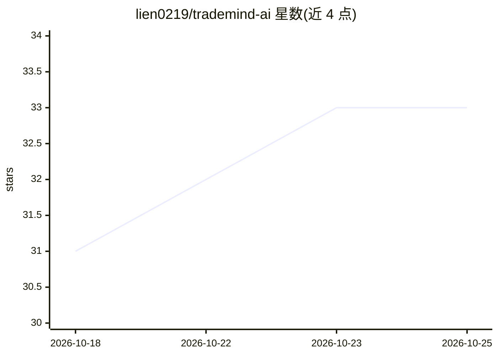

# lien0219/trademind-ai

⭐ 34 · Go · Apache-2.0 · 推送 2026-10-24 · [GitHub](https://github.com/lien0219/trademind-ai) · 个人维护 · 中文 README

**面向跨境卖家的开源 AI 电商运营与 ERP 平台**

自托管的开源跨境电商运营平台，将商品采集（1688/拼多多/淘宝）、商品草稿管理、AI 标题与描述生成、AI 图片处理、多平台刊登、订单与库存协同、ERP 采购退货、售后与结算等串成可观测工作流。技术栈为 Go+Gin 后端、React+Ant Design Pro 管理端、Node.js+Playwright 采集器、PostgreSQL+Redis，通过 Provider 架构扩展 AI/存储/图片/平台/采集能力，提供 Docker Compose 部署与 GHCR 预构建镜像。关键写路径带幂等保护，AI 结果支持人工应用与撤销，抖店写入经审核式草稿流程。

## 筛选速览

| 维度 | 判定 | 备注 |
|---|---|---|
| AI 角色 | `ai-enhanced` | 去掉 AI 部分产品仍成立 |
| 许可风险 | `permissive` | Apache-2.0 |
| 部署形态 | `self-host` | docker 或自建部署 |
| 模型依赖 | — | README 未给出锁定关系 |
| 硬件要求 | — | 无带数字的原话,不猜 |
| 安装摩擦 | `low` | 无编译、无系统依赖或容器化 |
| 成熟度 | — | 结构信号不足 |

## 能力要点

- 商品采集→草稿→AI 内容优化→多平台刊登的完整工作流
- 覆盖订单同步、库存镜像、采购退货、售后与结算的 ERP 能力
- Provider 架构统一扩展 AI/存储/图片/平台/采集器
- Docker Compose 完整部署与 GHCR 预构建镜像、Trivy 门禁

## 适用场景

- 跨境团队自建私有化商品采集与刊登工作台
- 用 AI 生成商品标题与描述并人工确认后发布
- 统一管理多店铺订单、库存与采购退货流程

## 场景标签

`网页抓取` `AI 写作` · 领域:效率与自动化

## 证据(README 行号)

> L24: TradeMind 是面向跨境卖家、品牌团队与开发者的开源 AI 运营平台。它把商品采集、信息整理、内容生成、图片处理、草稿协同、平台刊登、订单与库存协同串成一条可观测的工作流，让团队从“重复搬运商品”升级为“持续经营商品资产”。
> L62: - AI 内容：支持标题优化、描述生成、Prompt 模板、结果对比、人工应用与撤销。
> L63: - AI 图片：支持 remove.bg、OpenAI Image、ComfyUI 等 Provider，并通过异步任务队列执行。

## 星数曲线

2026-10-18 31 → 2026-10-25 33（+2）

---
*卡片 v1 · prompt 1.4 · 生成 2026-10-25 · 置信度 mid · 依据 README sha `5e6414eec8c9` · [字段定义](../../DATASET.md)*
