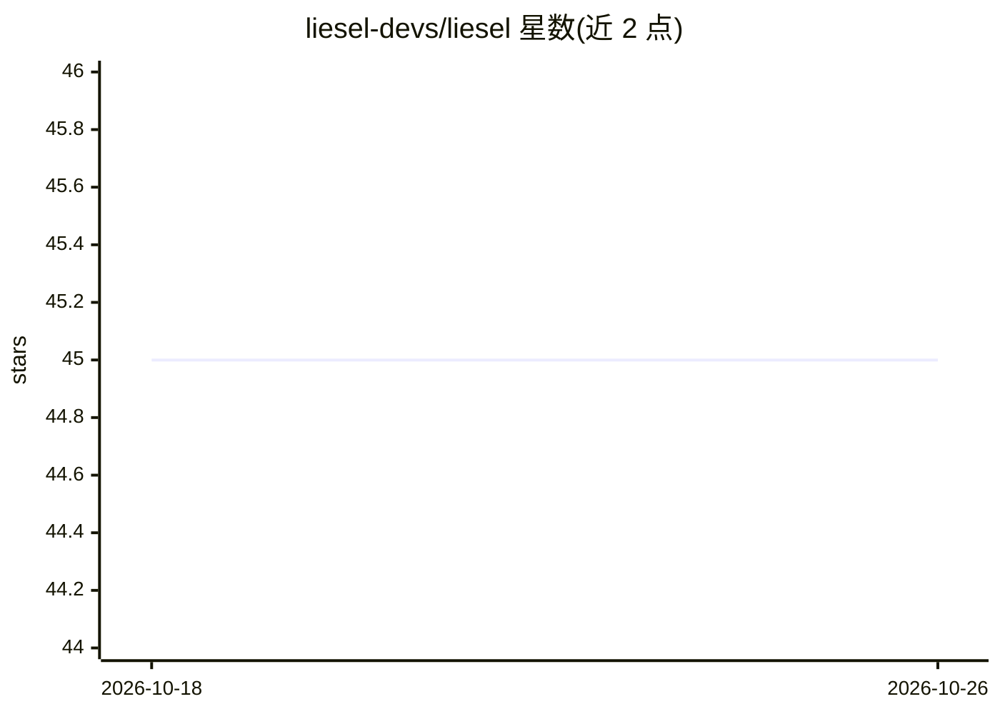

# liesel-devs/liesel

⭐ 45 · Python · MIT · 推送 2026-10-21 · [GitHub](https://github.com/liesel-devs/liesel) · [官网](https://liesel-project.org) · 组织维护

**面向半参数回归的概率编程框架，供统计建模与 MCMC 推断**

Python 概率编程框架，含三个部分：Liesel 以概率图模型（PGM）表达统计模型；Goose 用于构建自定义 MCMC 算法，内置 NUTS、IWLS 与多种 Gibbs 采样核，并处理采样记录与链后处理；Liesel-GAM 辅助配置 GAMLSS 等半参数回归模型，支持多种响应分布、样条平滑项与收缩先验。基于 JAX，要求 Python ≥ 3.13，Windows 上 jaxlib 无官方 wheel，建议使用 WSL。面向统计建模与回归分析的研究者和开发者。

## 筛选速览

| 维度 | 判定 | 备注 |
|---|---|---|
| AI 角色 | `ai-native` | 本体是模型或模型工具 |
| 许可风险 | `permissive` | MIT |
| 部署形态 | `library` | 以包/库形式分发 |
| 模型依赖 | — | README 未给出锁定关系 |
| 硬件要求 | — | 无带数字的原话,不猜 |
| 安装摩擦 | `low` | 无编译、无系统依赖或容器化 |
| 成熟度 | — | 结构信号不足 |

## 能力要点

- 以概率图模型（PGM）表达并更新统计模型
- Goose 提供可组合多参数块的 MCMC 算法构建（NUTS/IWLS/Gibbs）
- Liesel-GAM 支持 GAMLSS、样条平滑项与收缩先验
- 输出参数摘要表（ess/rhat）与诊断图

## 适用场景

- 构建贝叶斯统计模型并用 NUTS 等 MCMC 采样估计参数
- 配置半参数回归（GAMLSS）并选择响应分布
- 自定义多参数块、多采样核的 MCMC 算法

## 场景标签

 · 领域:统计/概率编程

## 证据(README 行号)

> L12: Liesel is a probabilistic programming framework with a focus on
> L18: - **Goose**, a library to build custom MCMC algorithms with several
> L76: We can estimate the mean parameter with Goose and a NUTS sampler.

## 星数曲线

2026-10-18 45 → 2026-10-26 45（+0）

---
*卡片 v1 · prompt 1.4 · 生成 2026-10-25 · 置信度 high · 依据 README sha `d128224ec04f` · [字段定义](../../DATASET.md)*
