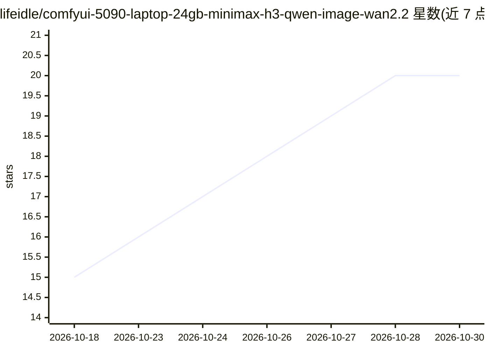

# lifeidle/comfyui-5090-laptop-24gb-minimax-h3-qwen-image-wan2.2

⭐ 20 · HTML · MIT · 推送 2026-10-11 · [GitHub](https://github.com/lifeidle/comfyui-5090-laptop-24gb-minimax-h3-qwen-image-wan2.2) · [官网](https://lifeidle.github.io/comfyui-5090-laptop-24gb-minimax-h3-qwen-image-wan2.2/) · 个人维护 · 中文 README

**在 24GB RTX 5090 笔记本上用 ComfyUI 跑通生成模型的实测手册**

一份面向本地生成模型选型的中英双语实战手册：作者在 RTX 5090 Laptop（24GB，Blackwell sm_120）上实测 13 条开源图像/视频/音乐/3D 生成模型线、28 组配置，给出选型总表、三套按画质/效率/场景组织的方案与授权商用矩阵。手册含量化格式四流派的拆解、三级回退的多源下载机制（modelscope/hf-mirror/huggingface）、ComfyUI 节点约束、以及用受控 A/B 与噪声基线验证 NVFP4 量化损失的方法论。所有限制结论均绑定 24GB 显存这一硬约束与本机实测环境。

## 筛选速览

| 维度 | 判定 | 备注 |
|---|---|---|
| AI 角色 | `ai-knowledge` | 知识聚合/清单类 |
| 许可风险 | `permissive` | MIT |
| 部署形态 | `desktop` | 安装包/桌面程序 |
| 模型依赖 | — | README 未给出锁定关系 |
| 硬件要求 | — | 无带数字的原话,不猜 |
| 安装摩擦 | `medium` | 含编译或系统依赖之一 |
| 成熟度 | — | 结构信号不足 |

## 能力要点

- 实测 13 条模型线 / 28 组配置，覆盖图像、视频、音乐、图生 3D
- NVFP4 vs INT8 的受控 A/B：含确定性检验与随机种子噪声地板
- 模型scope→hf-mirror→huggingface 三级回退下载与静默看门狗机制
- 标注各模型商用授权边界的授权矩阵

## 适用场景

- 我只有 24GB 显存的笔记本，想判断哪些最新生成模型能跑、该选哪个量化版本
- 我想用可复现的方法验证 4-bit 量化是否损伤画质
- 商用前查各开源模型的授权限制

## 场景标签

`图像生成` `视频生成` `模型量化` `教程课程` · 领域:内容生成

## 证据(README 行号)

> L3: **一份从选型、下载、搭图、实测到定论的完整实战手册**
> L15: 本文把我们的完整决策链摊开：怎么想、怎么下、怎么搭、怎么测、怎么选。所有数字都是本机实测，

## 星数曲线

2026-10-18 15 → 2026-10-30 20（+5）

---
*卡片 v1 · prompt 1.4 · 生成 2026-10-28 · 置信度 high · 依据 README sha `6fe3e32b7555` · [字段定义](../../DATASET.md)*
