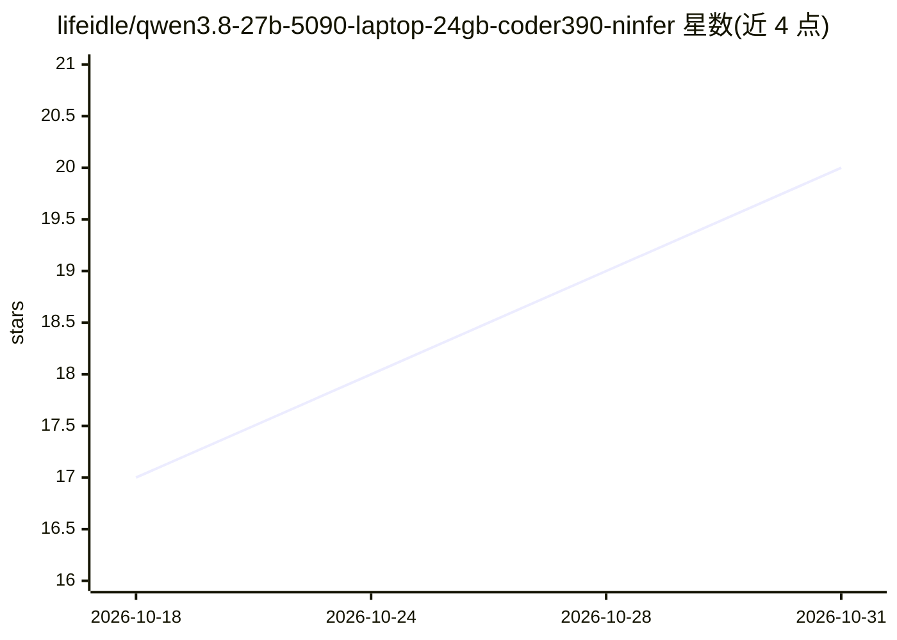

# lifeidle/qwen3.8-27b-5090-laptop-24gb-coder390-ninfer

⭐ 20 · Python · NOASSERTION · 推送 2026-10-16 · [GitHub](https://github.com/lifeidle/qwen3.8-27b-5090-laptop-24gb-coder390-ninfer) · 个人维护 · 中文 README

**RTX 5090 笔记本 24GB 上跑 Qwen3.8-27B 的实测基准与调优记录仓**

围绕在 24GB 单卡笔记本上部署 Qwen3.8-27B 的完整实测档案：以三大对决组织——并发取舍（mc1-7 并发爬梯、MTP 草稿长度、KV 格式 rk4v4/fp8/rk8v4/bf16 对比）、部署路线（llama.cpp 原生 vs NInfer WSL2+Docker）、模型架构（27B Dense vs 125B MoE）。全部数字采用服务端计时口径并附测量纪律与复现命令，提供 docker run 命令、双击启动器与基准脚本（bench-one.py/bench-par.py/matrix 脚本）。含故障排查表、FAQ 与 12 轮调优历程归档，数据按 CC BY 4.0、脚本按 MIT 授权。

## 筛选速览

| 维度 | 判定 | 备注 |
|---|---|---|
| AI 角色 | `ai-knowledge` | 知识聚合/清单类 |
| 许可风险 | `none` | NOASSERTION |
| 部署形态 | `desktop` | 安装包/桌面程序 |
| 模型依赖 | local-ok | 支持本地模型 |
| 硬件要求 | — | 无带数字的原话,不猜 |
| 安装摩擦 | `low` | 无编译、无系统依赖或容器化 |
| 成熟度 | — | 结构信号不足 |

## 能力要点

- 262K 满窗 3 路并发 192-195 tok/s 聚合吞吐等全套服务端计时实测
- llama.cpp 与 NInfer（WSL2+Docker）双部署路线的对比与切换方案
- KV 格式与 MTP 草稿长度的矩阵实测（48/64 格原始数据）
- 提供 bench-one.py / bench-par.py / matrix 自动跑批脚本与双击启动器

## 适用场景

- 我在 24GB 显存笔记本上想确认 27B 模型能跑多快、开多大上下文
- 我在 llama.cpp 与 NInfer/Docker 部署路线之间做选型
- 我需要复现或借鉴 MTP/KV 格式/并发参数的调优结论
- 我遇到显存溢出、finalizing target 等部署故障需要排查参考

## 场景标签

`模型评测` · 领域:评测与运维

## 证据(README 行号)

> L3: **Qwen3.8 家族在这块 24GB 笔记本卡上的完整对决与定版 —— 27B Dense 双引擎路线，3 路并发 × 262K 满窗，短文并发 194.8 tok/s，每个数字都是服务端计时实测**
> L151: **测量纪律**（本项目所有数字的来源规则）：
> L158: **测速与扫描脚本**：`scripts/bench-one.py`（单发，读服务端 timings）· `scripts/bench-par.py`（并发基准 + MTP 接受率）· `scripts/matrix-round

## 星数曲线

2026-10-18 17 → 2026-10-31 20（+3）

---
*卡片 v1 · prompt 1.4 · 生成 2026-10-28 · 置信度 mid · 依据 README sha `e50e8c395b61` · [字段定义](../../DATASET.md)*
