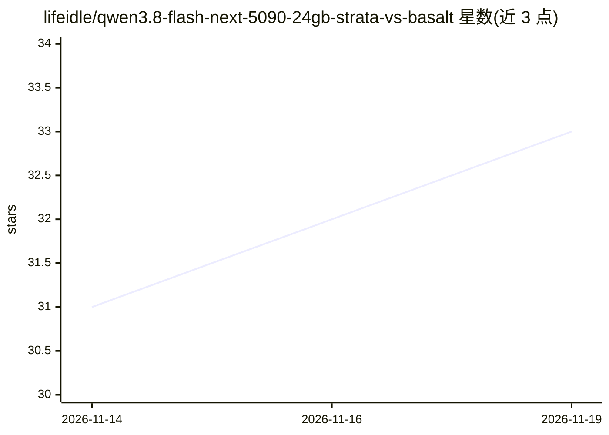

# lifeidle/qwen3.8-flash-next-5090-24gb-strata-vs-basalt

⭐ 33 · Python · MIT · 推送 2026-11-14 · [GitHub](https://github.com/lifeidle/qwen3.8-flash-next-5090-24gb-strata-vs-basalt) · [官网](https://lifeidle.github.io/qwen3.8-flash-next-5090-24gb-strata-vs-basalt/) · 个人维护 · 中文 README

**RTX 5090 24GB 上运行 Qwen3.8-Flash-Next 177B 的实测基准记录**

个人维护的本地推理实测实录：在同一台 RTX 5090 Laptop 24GB、63.4 GB 内存机器上，对比 Strata 与 Basalt 引擎运行 Qwen3.8-Flash-Next 177B MoE 的吞吐表现，覆盖单/双/多路并发、三个量化档、冷态与热态测量、speculative decoding 参数扫描与 KV 精度对比，并给出复现命令与配置文件。全部数字为本机实测，模型文件来自 Unsloth 与 ISTA-DASLab 的公开 GGUF 重打包。限制：Windows 下未跑质量门，3 路长上下文崩溃未定位。

## 筛选速览

| 维度 | 判定 | 备注 |
|---|---|---|
| AI 角色 | `ai-knowledge` | 知识聚合/清单类 |
| 许可风险 | `permissive` | MIT |
| 部署形态 | `None` |  |
| 模型依赖 | — | README 未给出锁定关系 |
| 硬件要求 | — | 无带数字的原话,不猜 |
| 安装摩擦 | `medium` | 含编译或系统依赖之一 |
| 成熟度 | — | 结构信号不足 |

## 能力要点

- Strata vs Basalt 同机对照：单路 96.1→143.3 tok/s，双路 67.5→163.9 tok/s
- 三个量化档（UD-IQ1_S / UD-IQ3_XXS / IQ3_S）的速度/质量/RAM 占用对比
- 冷态 vs 热态测量方法论：冷态虚高 37-52% 且不可复现
- spec 2-12 全档扫描与专家显存/内存/SSD 分层机制解释

## 适用场景

- 在 24GB 消费级 GPU 上选型本地运行 177B MoE 的引擎与量化方案
- 参考长上下文并发的实测数据与热态测量方法
- 复用配置文件与启动脚本搭建多窗口本地推理服务

## 场景标签

`模型评测` `模型量化` · 领域:评测与运维

## 证据(README 行号)

> L7: > 全部数字来自本机实测（同一台机器、同一批模型文件、可复现命令在文末）。
> L213: ```powershell

## 星数曲线



2026-11-14 31 → 2026-11-19 33（+2）


---
*卡片 v1 · prompt 1.4 · 生成 2026-11-18 · 置信度 high · 依据 README sha `819105ba95c9` · [字段定义](../../DATASET.md)*
