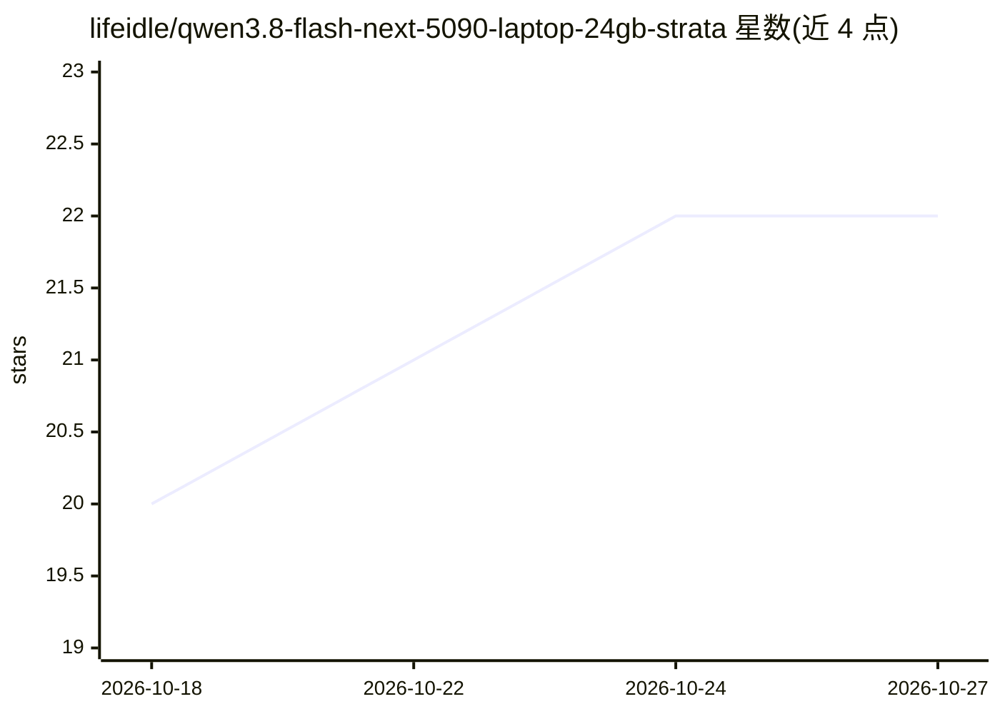

# lifeidle/qwen3.8-flash-next-5090-laptop-24gb-strata

⭐ 22 · Python · MIT · 推送 2026-10-20 · [GitHub](https://github.com/lifeidle/qwen3.8-flash-next-5090-laptop-24gb-strata) · [官网](https://lifeidle.github.io/qwen3.8-flash-next-5090-laptop-24gb-strata/) · 个人维护 · 中文 README

**在 RTX 5090 笔记本上自托管 Qwen3.8-Flash-Next 177B 的调优实录**

个人维护的实测记录仓库：记录在一台 24GB 显存 + 64GB 内存的 RTX 5090 Laptop 上，通过 Strata 引擎运行 Qwen3.8-Flash-Next 177B MoE 量化版的完整调优过程。内容含 7 个量化档位筛选、26 轮实测、25+ 组参数扫描、MTP 推测解码权重损坏事故复盘与修复工具链、256K 上下文配置方法，以及与同机 27B NVFP4 方案的分工对比。仓库本身不分发模型权重，只含数据、文档与可复用工具，附移植到其他硬件的指南。

## 筛选速览

| 维度 | 判定 | 备注 |
|---|---|---|
| AI 角色 | `ai-knowledge` | 知识聚合/清单类 |
| 许可风险 | `permissive` | MIT |
| 部署形态 | `library` | 以包/库形式分发 |
| 模型依赖 | local-ok | 支持本地模型 |
| 硬件要求 | `gpu-24g` | |
| 安装摩擦 | `medium` | 含编译或系统依赖之一 |
| 成熟度 | — | 结构信号不足 |

## 能力要点

- 7 个量化档位（Q2_0 至 IQ3_S）逐一给出优势/取舍/实测结果档案
- MTP 草稿层权重损坏事故完整复盘与检测/修复工具链
- 256K 上下文 + Vision 并存的配置方法与上下文档位实测数据
- IQ3_S 与 IQ3_XXS 双现役配置的选型对照表

## 适用场景

- 在 24GB 显存消费级笔记本上部署 177B MoE 模型前查参考配置
- 了解 Strata 引擎的量化选型、MTP 与 KV 流式配置经验
- 排查 MTP 推测解码草稿权重损坏问题

## 场景标签

`模型量化` `推理引擎` · 领域:训练与推理

## 证据(README 行号)

> L240: 本仓库记录了从零开始的**完整调优过程**：量化选型、三层内存分配、参数扫描、以及 **12 项试过但无效的方向**（避免重复踩坑）。
> L243: > 🧪 **原始实测数据** → results/
> L244: > 🛠 **可复用测试工具** → tools/

## 星数曲线

2026-10-18 20 → 2026-10-27 22（+2）

---
*卡片 v1 · prompt 1.4 · 生成 2026-10-27 · 置信度 mid · 依据 README sha `7fa85b07cb97` · [字段定义](../../DATASET.md)*
