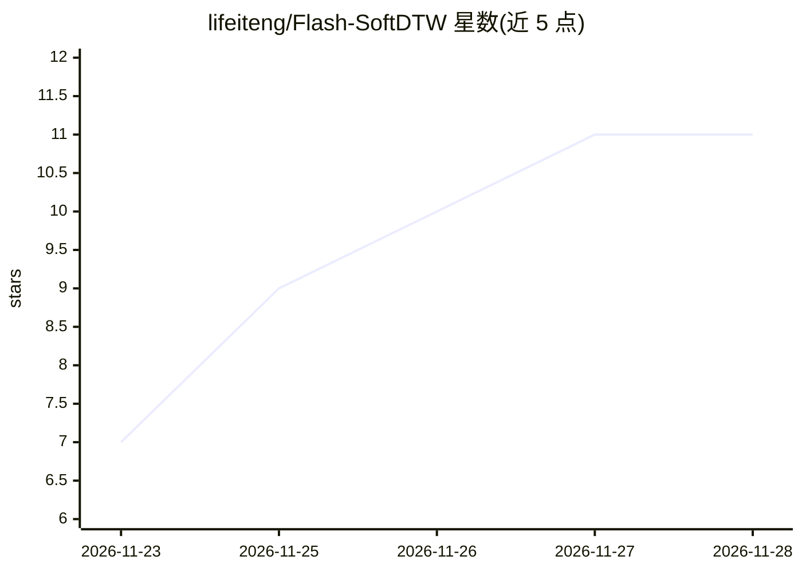

# lifeiteng/Flash-SoftDTW

⭐ 11 · Python · Apache-2.0 · 推送 2026-11-22 · [GitHub](https://github.com/lifeiteng/Flash-SoftDTW) · [官网](https://pypi.org/project/flash-softdtw-torch/) · 个人维护 · 中文 README

**PyTorch 的 soft-DTW 可微损失库：批量快速计算值与梯度**

面向 PyTorch 训练场景的 soft 动态时间规整实现：对一批代价矩阵计算 soft-DTW 值及其精确梯度（期望对齐）。支持变长批量、Sakoe-Chiba 带约束、warp 惩罚、fp16/bf16 输入与非连续输入；提供稠密与紧凑带状两种存储布局，CUDA 与 CPU 双后端，反向传播通过重算转移概率节省显存。以 PyPI 源码分发安装，安装时编译扩展，无 CUDA 工具链时仅构建 CPU 后端。

## 筛选速览

| 维度 | 判定 | 备注 |
|---|---|---|
| AI 角色 | `ai-native` | 本体是模型或模型工具 |
| 许可风险 | `permissive` | Apache-2.0 |
| 部署形态 | `library` | 以包/库形式分发 |
| 模型依赖 | — | README 未给出锁定关系 |
| 硬件要求 | — | 无带数字的原话,不猜 |
| 安装摩擦 | `high` | 编译与系统依赖俱全 |
| 成熟度 | — | 结构信号不足 |

## 能力要点

- 提供 soft_dtw、SoftDTWLoss、pairwise_cost、sakoe_chiba_band 等 API
- 支持任意长度序列（README 称测试至 4096×4096）与任意带宽约束
- 带状对齐内存随带宽 W 而非序列长度 S 扩展
- 约 600 个测试用例对照独立 float64 参考实现

## 适用场景

- 在语音/时序模型训练中作为可微损失函数
- 批量计算变长时间序列的 soft-DTW 值与梯度
- 需要在带约束下对齐长序列且内存受限的场景

## 场景标签

 · 领域:机器学习/时序分析

## 证据(README 行号)

> L9: Flash-SoftDTW computes the soft dynamic time warping value of a batch of cost
> L5: **Fast, memory-lean, exact soft-DTW for PyTorch — CUDA and CPU, dense and banded, forward and backward.**

## 星数曲线

2026-11-23 7 → 2026-11-28 11（+4）

---
*卡片 v1 · prompt 1.4 · 生成 2026-11-23 · 置信度 high · 依据 README sha `a48bf1d6e9aa` · [字段定义](../../DATASET.md)*
