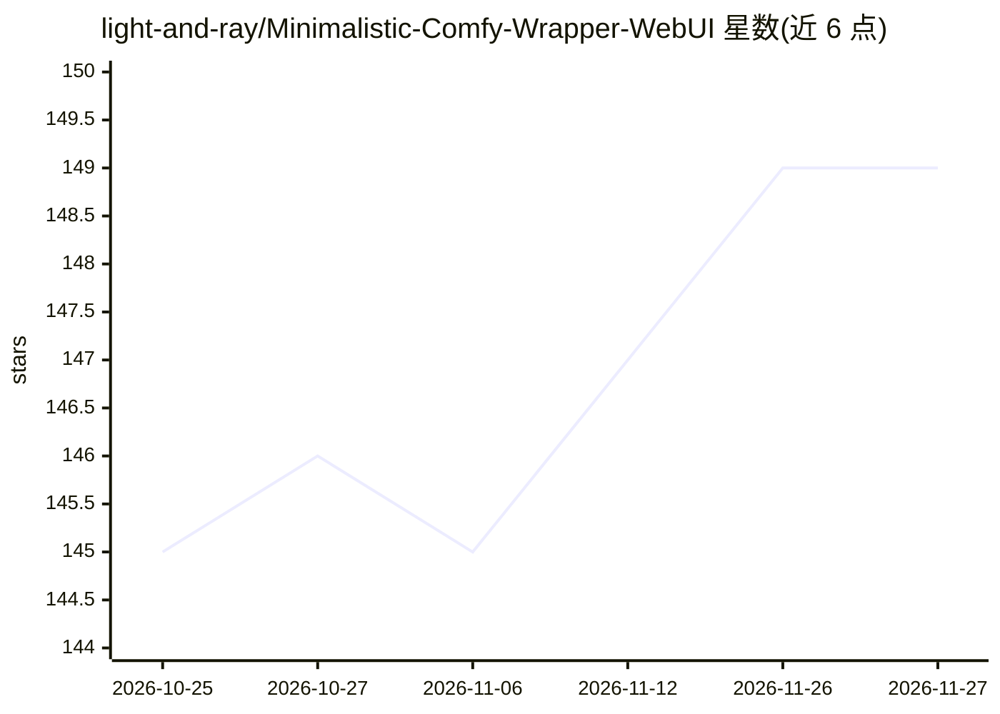

# light-and-ray/Minimalistic-Comfy-Wrapper-WebUI

⭐ 149 · Python · AGPL-3.0 · 推送 2026-10-25 · [GitHub](https://github.com/light-and-ray/Minimalistic-Comfy-Wrapper-WebUI) · [官网](https://registry.comfy.org/publishers/light-and-ray/nodes/mcww-webui) · 个人维护

**为 ComfyUI 用户提供推理向的非节点式简化界面**

基于 Gradio 的 ComfyUI 扩展，也支持独立服务器运行，面向想用更简单方式执行工作流推理的用户。用户通过给节点标题添加特殊格式标记（如 output/prompt/advanced 类别），点击 Refresh 后界面动态适配工作流，无需导出 api 格式。特性包括状态持久化到浏览器本地存储、可调整优先级的任务队列、提示词预设、批量支持、内置图片编辑器和移动端/PWA 支持；不支持 Python 3.14+。

## 筛选速览

| 维度 | 判定 | 备注 |
|---|---|---|
| AI 角色 | `ai-ecosystem` | LLM/agent 周边工具 |
| 许可风险 | `viral` | AGPL-3.0 |
| 部署形态 | `None` |  |
| 模型依赖 | — | README 未给出锁定关系 |
| 硬件要求 | — | 无带数字的原话,不猜 |
| 安装摩擦 | `low` | 无编译、无系统依赖或容器化 |
| 成熟度 | — | 结构信号不足 |

## 能力要点

- 界面按节点标题标记动态适配 ComfyUI 工作流，无需导出 api 格式
- 队列支持调整顺序与优先级、暂停/恢复、中断后继续生成
- 提示词预设与批量输入/批量 seed 支持
- 移动端友好，可经浏览器或 PWA 在局域网使用

## 适用场景

- 用手机通过 PWA 在局域网执行 ComfyUI 生成任务
- 把已有 ComfyUI 工作流以更简单的界面跑推理
- 管理长时间批量生成任务并调整队列优先级

## 场景标签

`图像生成` `视频生成` · 领域:内容生成

## 证据(README 行号)

> L6: This is a UI extension for ComfyUI adding an additional inference focused UI, that dynamically adapts to your workfl
> L19: 1. Mobile friendly UI. You can use it in browser or as PWA app over local network. Read this for details

## 星数曲线

2026-10-25 145 → 2026-11-27 149（+4）

---
*卡片 v1 · prompt 1.4 · 生成 2026-11-27 · 置信度 high · 依据 README sha `6dda0c3a3673` · [字段定义](../../DATASET.md)*
