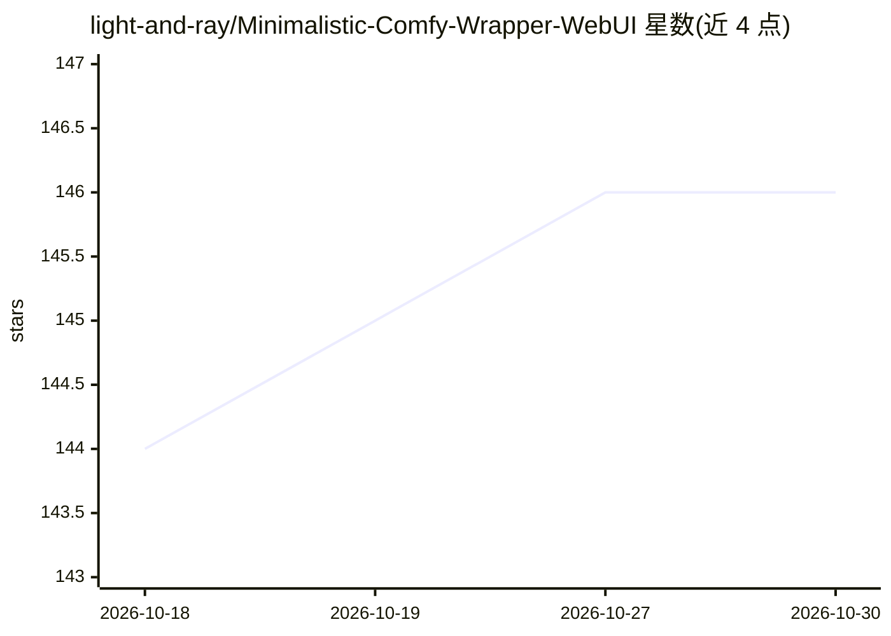

# light-and-ray/Minimalistic-Comfy-Wrapper-WebUI

⭐ 146 · Python · AGPL-3.0 · 推送 2026-10-25 · [GitHub](https://github.com/light-and-ray/Minimalistic-Comfy-Wrapper-WebUI) · [官网](https://registry.comfy.org/publishers/light-and-ray/nodes/mcww-webui) · 个人维护

**为 ComfyUI 附加的轻量推理 UI，可独立运行**

基于 Gradio 的 ComfyUI 扩展，提供面向推理的简化界面：通过特殊格式的节点标题标记输入/输出节点，UI 随工作流动态适配；也可作为独立服务器运行。功能包括浏览器本地存储保持界面状态、任务队列排序与暂停恢复、提示词预设、批处理与内置图片编辑器，支持移动端浏览器与 PWA。安装途径为 ComfyUI Manager 或参考 installation.md；因旧版 gradio 依赖不支持 Python 3.14 及以上。

## 筛选速览

| 维度 | 判定 | 备注 |
|---|---|---|
| AI 角色 | `ai-ecosystem` | LLM/agent 周边工具 |
| 许可风险 | `viral` | AGPL-3.0 |
| 部署形态 | `None` |  |
| 模型依赖 | — | README 未给出锁定关系 |
| 硬件要求 | — | 无带数字的原话,不猜 |
| 安装摩擦 | `low` | 无编译、无系统依赖或容器化 |
| 成熟度 | — | 结构信号不足 |

## 能力要点

- 通过节点标题特殊格式动态适配工作流的推理界面
- 队列任务可调整顺序/优先级并暂停恢复
- 提示词预设与批处理（媒体匹配、批量预设、seed 计数）
- 移动端可用，支持浏览器与 PWA 应用方式

## 适用场景

- 在手机或简化界面上运行已有的 ComfyUI 工作流做推理
- 在 ComfyUI 与简化 UI 之间共用同一批工作流
- 批量生成图片并管理任务队列

## 场景标签

`图像生成` `视频生成` · 领域:内容生成

## 证据(README 行号)

> L6: This is a UI extension for ComfyUI adding an additional inference focused UI, that dynamically adapts to your workfl
> L10: You have working workflows inside your ComfyUI installation, but you would want to work with them from a different 

## 星数曲线

2026-10-18 144 → 2026-10-30 146（+2）

---
*卡片 v1 · prompt 1.4 · 生成 2026-10-22 · 置信度 high · 依据 README sha `6930236559d8` · [字段定义](../../DATASET.md)*
