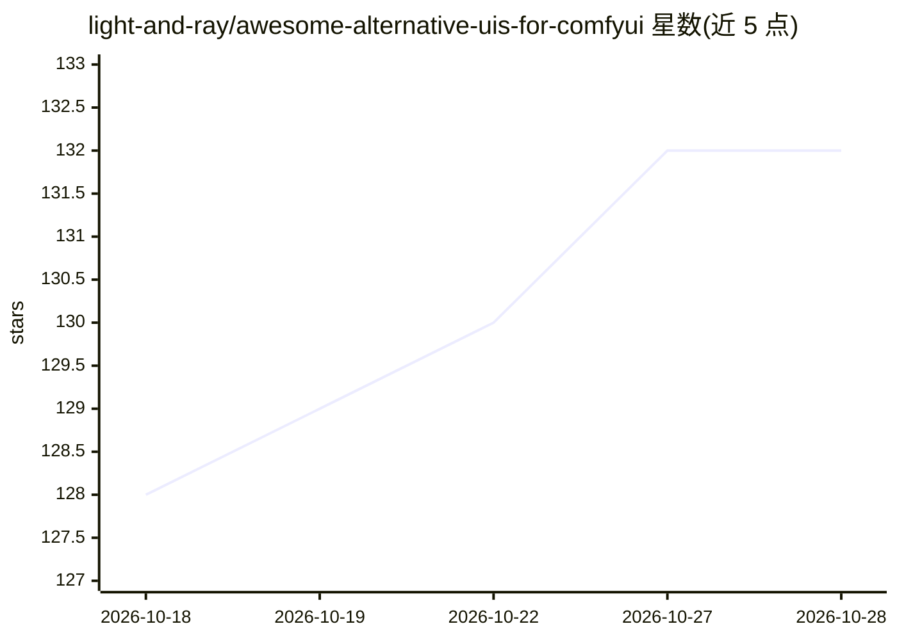

# light-and-ray/awesome-alternative-uis-for-comfyui

⭐ 132 · 推送 2026-10-23 · [GitHub](https://github.com/light-and-ray/awesome-alternative-uis-for-comfyui) · 个人维护

**使用 ComfyUI 后端的替代 UI 工具合集清单**

由 light-and-ray 维护的聚合清单，收录使用 ComfyUI 后端进行图像/视频生成的替代界面项目，按两类组织：与 ComfyUI 工作流紧密集成的 UI（桌面端、移动端、Photoshop 插件、Python 前端等），以及面向 API 格式导出工作流的 UI（Web 应用生成器、Krita 插件、Android 客户端等）。清单声明未经策展，按提交顺序排列，每条附截图与项目自述，通过 issue/PR 接收新增条目。

## 筛选速览

| 维度 | 判定 | 备注 |
|---|---|---|
| AI 角色 | `ai-knowledge` | 知识聚合/清单类 |
| 许可风险 | `none` | — |
| 部署形态 | `None` |  |
| 模型依赖 | — | README 未给出锁定关系 |
| 硬件要求 | — | 无带数字的原话,不猜 |
| 安装摩擦 | `low` | 无编译、无系统依赖或容器化 |
| 成熟度 | — | 结构信号不足 |

## 能力要点

- 收录 40+ 个基于 ComfyUI 后端的替代 UI 项目
- 按集成深度分两类：同工作流紧密集成 / API 格式工作流 UI
- 每条提供截图与项目自述及链接，通过 PR 收录新条目

## 适用场景

- 为 ComfyUI 寻找移动端、桌面端或嵌入创意软件的界面
- 比较可将 ComfyUI 工作流转成 Web 应用或 API 的工具
- 发现特定平台（Photoshop/Krita/Android）上的 ComfyUI 前端

## 场景标签

`精选清单` `图像生成` `视频生成` · 领域:内容生成

## 证据(README 行号)

> L1: # Awesome Alternative UIs for ComfyUI
> L3: Here is a collection of alternative UI that use ComfyUI backend for image generation. The order doesn't matter. Don'

## 星数曲线

2026-10-18 128 → 2026-10-28 132（+4）

---
*卡片 v1 · prompt 1.4 · 生成 2026-10-23 · 置信度 high · 依据 README sha `60a844360084` · [字段定义](../../DATASET.md)*
