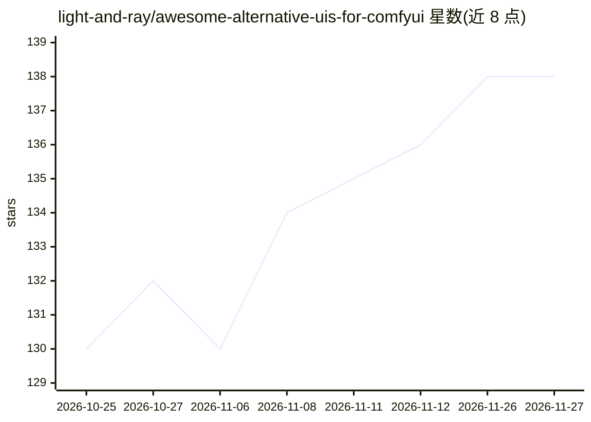

# light-and-ray/awesome-alternative-uis-for-comfyui

⭐ 138 · 推送 2026-10-31 · [GitHub](https://github.com/light-and-ray/awesome-alternative-uis-for-comfyui) · 个人维护

**基于 ComfyUI 后端的替代 UI 收录清单**

一份收录使用 ComfyUI 后端进行图像/视频生成的替代前端界面的清单，按两类组织：与原工作流紧密集成的 UI，以及面向 API 导出格式工作流的 UI。每条目附项目截图与项目自述简介，并提供项目链接；清单声明不做策展排序，接受 issue/PR 补充收录。覆盖移动端客户端、桌面应用、Photoshop/GIMP/Krita 插件、Python 前端、工作流转 Web 应用/ API 工具等形态。

## 筛选速览

| 维度 | 判定 | 备注 |
|---|---|---|
| AI 角色 | `ai-knowledge` | 知识聚合/清单类 |
| 许可风险 | `none` | — |
| 部署形态 | `None` |  |
| 模型依赖 | — | README 未给出锁定关系 |
| 硬件要求 | — | 无带数字的原话,不猜 |
| 安装摩擦 | `low` | 无编译、无系统依赖或容器化 |
| 成熟度 | — | 结构信号不足 |

## 能力要点

- 两类组织：紧密集成同一工作流 / 面向 API 格式导出的工作流
- 每条目附截图与项目自述简介
- 收录桌面、移动端、设计软件插件、Python 前端等多种形态
- 开放 issue/PR 补充收录

## 适用场景

- 为 ComfyUI 寻找更简洁或移动端可用的前端界面
- 把已有 ComfyUI 工作流转成 Web 应用或 API
- 在设计软件（Krita/Photoshop/GIMP）中接入 ComfyUI 生成

## 场景标签

`图像生成` `视频生成` `精选清单` · 领域:内容生成

## 证据(README 行号)

> L1: # Awesome Alternative UIs for ComfyUI
> L3: Here is a collection of alternative UI that use ComfyUI backend for image generation. The order doesn't matter. Don'
> L163: # Category 2: UI for workflows exported in API format

## 星数曲线

2026-10-25 130 → 2026-11-27 138（+8）

---
*卡片 v1 · prompt 1.4 · 生成 2026-11-27 · 置信度 high · 依据 README sha `54f86b9625d8` · [字段定义](../../DATASET.md)*
