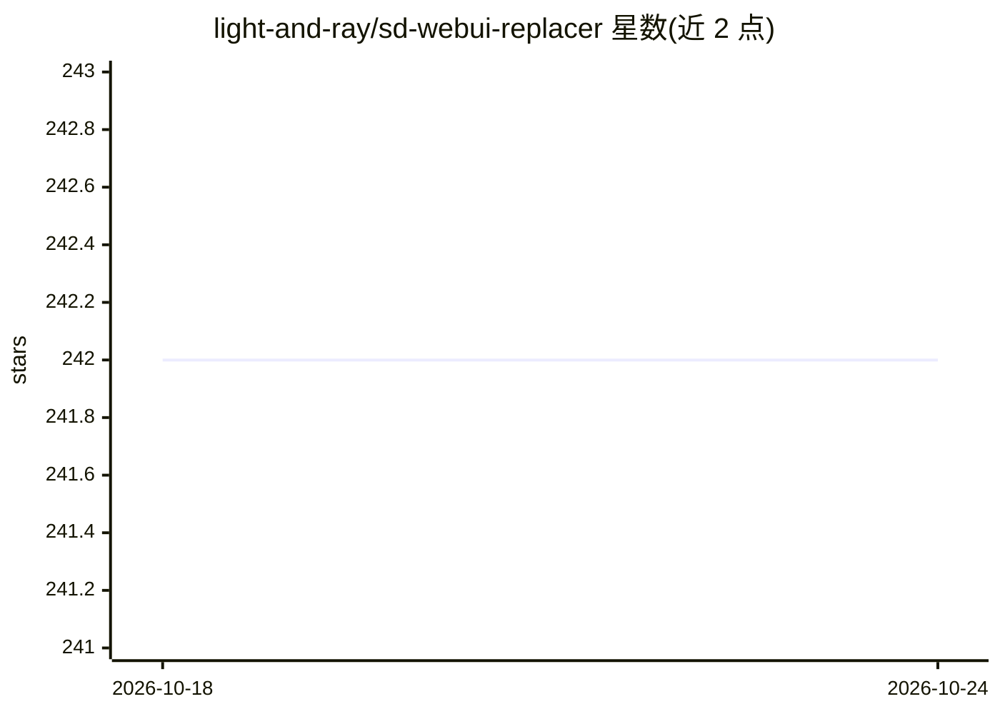

# light-and-ray/sd-webui-replacer

⭐ 242 · Python · 推送 2026-01-08 · [GitHub](https://github.com/light-and-ray/sd-webui-replacer) · 个人维护

**sd-webui 扩展：按检测提示词自动遮罩并替换图片/视频中的物体**

AUTOMATIC1111/stable-diffusion-webui 的扩展标签页，也兼容 reForge 与 forge-classic。工作流程：grounding dino 按检测提示词检测物体，segment anything 生成分割遮罩，随后自动执行 img2img inpainting 完成物体替换；支持手绘遮罩、HiresFix、ControlNet inpainting、批量处理，以及借助 AnimateDiff 进行视频 inpainting。安装依赖 sd-webui-segment-anything 扩展及对应 SAM 模型文件；作者声明已另发布后继项目 Minimalistic-Comfy-Wrapper-WebUI。

## 筛选速览

| 维度 | 判定 | 备注 |
|---|---|---|
| AI 角色 | `ai-native` | 本体是模型或模型工具 |
| 许可风险 | `none` | — |
| 部署形态 | `None` |  |
| 模型依赖 | — | README 未给出锁定关系 |
| 硬件要求 | `gpu-8g` | |
| 安装摩擦 | `low` | 无编译、无系统依赖或容器化 |
| 成熟度 | — | 结构信号不足 |

## 能力要点

- 检测提示词驱动的自动遮罩（grounding dino + segment anything）+ inpaint 一体化
- AnimateDiff + ControlNet 支持视频物体替换
- 批量 inpaint、HiresFix、保留原始分辨率与宽高比的 ControlNet inpainting
- 可选 SAM/SAM-HQ/MobileSAM 多种模型（39MB–2.57GB）

## 适用场景

- 用文字提示词替换图片中不需要的物体
- 逐帧或用 AnimateDiff 对视频做物体替换
- 批量对多张图片执行 inpaint

## 场景标签

`图像生成` `视频生成` · 领域:内容生成

## 证据(README 行号)

> L6: Replacer is an extension for AUTOMATIC1111/stable-diffusion-webui. Also should work in reForge and forge-classic. Th
> L51: First, grounding dino models detect objects you provided in the detection prompt. Then segment anything model gener

## 星数曲线

2026-10-18 242 → 2026-10-24 242（+0）

---
*卡片 v1 · prompt 1.4 · 生成 2026-10-22 · 置信度 high · 依据 README sha `22f0fc8b934a` · [字段定义](../../DATASET.md)*
