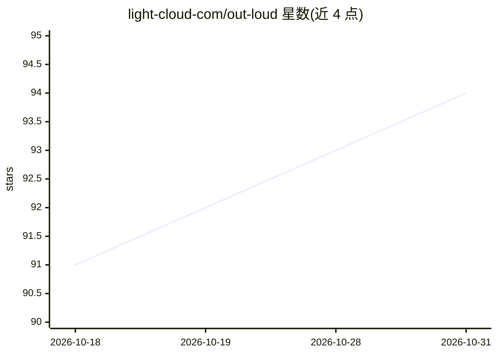

# light-cloud-com/out-loud

⭐ 94 · TypeScript · NOASSERTION · 推送 2026-08-04 · [GitHub](https://github.com/light-cloud-com/out-loud) · [官网](https://out-loud.io) · 组织维护

**100% 离线 AI 文字转语音桌面应用，读文本为自然语音**

面向普通用户的 Electron 桌面应用（macOS/Windows/Linux），基于开源权重模型 Kokoro-82M（ONNX，onnxruntime-node 本地推理）将文本朗读为语音：50+ 种声音、8 种语言（含中文普通话）。全部处理在本机进行，无云端无账号，文本不离开电脑。提供菜单栏/托盘集成、Talker 模式、暂停标签、Chrome/Safari 一键朗读网页扩展，并在本地 127.0.0.1:51730 暴露 HTTP API 供扩展与脚本调用。许可证为 PolyForm Noncommercial 1.0.0：非商业用途免费，禁止商用。

## 筛选速览

| 维度 | 判定 | 备注 |
|---|---|---|
| AI 角色 | `ai-native` | 本体是模型或模型工具 |
| 许可风险 | `none` | NOASSERTION |
| 部署形态 | `desktop` | 安装包/桌面程序 |
| 模型依赖 | — | README 未给出锁定关系 |
| 硬件要求 | — | 无带数字的原话,不猜 |
| 安装摩擦 | `low` | 无编译、无系统依赖或容器化 |
| 成熟度 | — | 结构信号不足 |

## 能力要点

- 基于 Kokoro-82M 开源权重 TTS 模型的完全离线推理
- 50+ 种声音、8 种语言，含中文普通话
- Chrome/Safari 扩展一键朗读网页
- 本地 HTTP API（端口 51730）支持声音混合公式与 OpenAPI 3.1 规范

## 适用场景

- 离线把文章、文档朗读为自然语音
- 通过浏览器扩展一键朗读网页内容
- 通过本地 HTTP API 在脚本中调用 TTS
- 无障碍场景下用 Talker 模式打字即发声

## 场景标签

`语音合成` · 领域:内容生成

## 证据(README 行号)

> L21: - Reads text aloud with 50+ natural voices across 8 languages
> L23: - Built on Kokoro-82M, an open-weight TTS model ranked highly on the TTS Arena
> L91: The Electron app owns the ONNX model, runs TTS in a worker thread, and exposes a local HTTP API on port `51730` tha

## 星数曲线

2026-10-18 91 → 2026-10-31 94（+3）

---
*卡片 v1 · prompt 1.4 · 生成 2026-10-23 · 置信度 mid · 依据 README sha `2f0e58a21483` · [字段定义](../../DATASET.md)*
