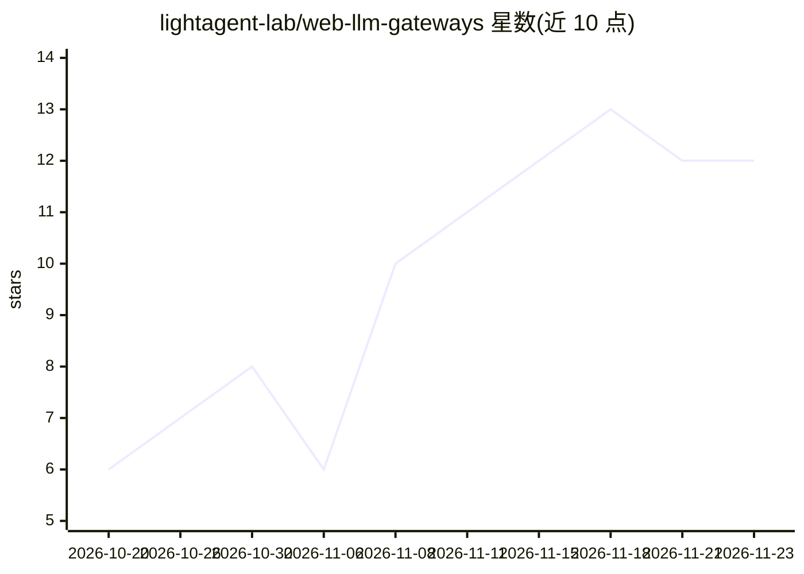

# lightagent-lab/web-llm-gateways

⭐ 12 · JavaScript · MIT · 推送 2026-09-16 · [GitHub](https://github.com/lightagent-lab/web-llm-gateways) · 个人维护 · 中文 README

**把豆包/DeepSeek/Kimi 网页版会话包装成 OpenAI 兼容接口的网关**

由三个独立子项目组成的网关集合：复用已人工登录的浏览器/CLI 会话，在 Docker 容器内运行 Chromium 并通过 noVNC 登录一次，登录态持久化到卷；网关把会话包装成 OpenAI 兼容的 Chat Completions / Responses HTTP 接口，并将上游 SSE 翻译为标准响应。单并发设计，仅支持文本对话，上游网页改版后需同步更新适配层。面向需要将网页版模型接入自建中转、客户端或自动化脚本的开发者。

## 筛选速览

| 维度 | 判定 | 备注 |
|---|---|---|
| AI 角色 | `ai-ecosystem` | LLM/agent 周边工具 |
| 许可风险 | `permissive` | MIT |
| 部署形态 | `self-host` | docker 或自建部署 |
| 模型依赖 | — | README 未给出锁定关系 |
| 硬件要求 | — | 无带数字的原话,不猜 |
| 安装摩擦 | `low` | 无编译、无系统依赖或容器化 |
| 成熟度 | — | 结构信号不足 |

## 能力要点

- 复用人工登录的浏览器/CLI 会话，包装成 OpenAI 兼容 HTTP 接口
- 登录态持久化到 Docker 卷，Cookie 与令牌留在容器内
- DeepSeek/Kimi 支持 Chat Completions 与 Responses 两种协议
- Kimi 走 Connect RPC（protobuf over HTTP）并在页面上下文旁路留存原始响应字节

## 适用场景

- 把网页版模型的登录会话接入自建 API 中转服务
- 让使用 OpenAI 兼容协议的客户端调用豆包/DeepSeek/Kimi 网页版
- 在自动化脚本中以标准接口调用网页版模型进行文本对话

## 场景标签

`模型网关` `浏览器自动化` · 领域:Agent 开发

## 证据(README 行号)

> L3: 把「网页版大模型」包装成标准 OpenAI 兼容接口的三件套，方便接入自建中转、客户端或自动化脚本。
> L20: 3. 网关把这层会话包装成 HTTP 接口，上游返回的 SSE 再翻译成标准响应格式。

## 星数曲线

2026-10-20 6 → 2026-11-23 12（+6）

---
*卡片 v1 · prompt 1.4 · 生成 2026-11-18 · 置信度 high · 依据 README sha `44dd377a0195` · [字段定义](../../DATASET.md)*
