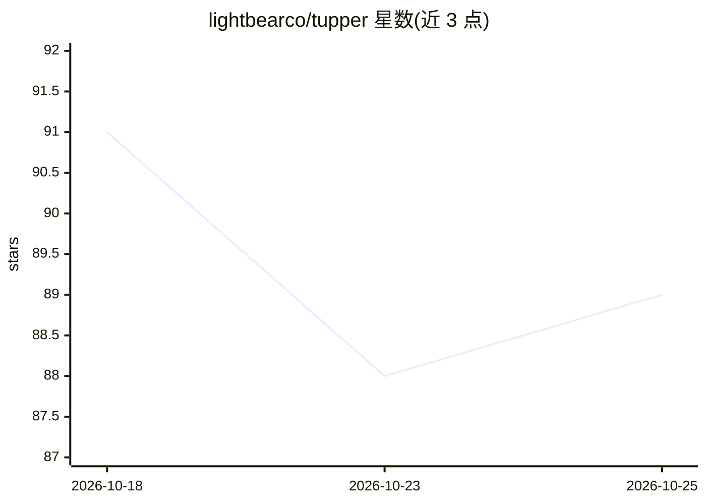

# lightbearco/tupper

⭐ 89 · TypeScript · MIT · 推送 2026-06-23 · [GitHub](https://github.com/lightbearco/tupper) · 组织维护

**自托管的 AI agent 代码执行沙箱，Apple Containers 隔离不可信代码**

为 AI agent 提供本地隔离执行环境的开源沙箱：以 E2B 风格的 TypeScript SDK（Sandbox.create()、commands.run()、files.*）在自有机器上运行不可信或 AI 生成的代码与 shell 命令。默认后端为 macOS 26+ 的 Apple Containers（无需 Docker daemon），Firecracker/Linux 与 WSL/Windows 后端分别为实验性与规划中；提供 CLI、HTTP API（Hono）与 MCP 服务器，并为 deepagents 与 Mastra 提供接入包。早期开发阶段，API 在 1.0 前可能变化。

## 筛选速览

| 维度 | 判定 | 备注 |
|---|---|---|
| AI 角色 | `ai-ecosystem` | LLM/agent 周边工具 |
| 许可风险 | `permissive` | MIT |
| 部署形态 | `library` | 以包/库形式分发 |
| 模型依赖 | — | README 未给出锁定关系 |
| 硬件要求 | — | 无带数字的原话,不猜 |
| 安装摩擦 | `low` | 无编译、无系统依赖或容器化 |
| 成熟度 | `idea` | |

## 能力要点

- E2B 风格 SDK，本地自托管运行，无需云账户
- macOS 原生 Apple Containers 后端，不依赖 Docker daemon，可运行任意 Linux OCI 镜像
- 后端按平台自注册，支持运行时切换（Apple Containers/Firecracker/WSL）
- 提供 MCP 服务器、CLI、HTTP API 及 deepagents/Mastra 集成包

## 适用场景

- 让 AI agent 在隔离环境中执行代码和 shell 命令而不危及宿主机
- 在自有基础设施上替代托管的 E2B/Daytona/Modal 代码执行服务
- 为 deepagents 或 Mastra agent 框架接入本地沙箱后端

## 场景标签

 · 领域:AI agent 基础设施/沙箱

## 证据(README 行号)

> L3: > Open-source **sandboxes for AI agents** — run untrusted, AI-generated code safely on your own machine. Backed by A
> L11: **Tupper** gives AI agents an isolated environment to execute code, run shell commands, and read and write files — 
> L24: - **Agent-framework ready** — drop-in sandbox backends for deepagents and Mastra, plus a Model Context Protocol ser

## 星数曲线

2026-10-18 91 → 2026-10-25 89（-2）

---
*卡片 v1 · prompt 1.4 · 生成 2026-10-23 · 置信度 mid · 依据 README sha `6bc07865f4b5` · [字段定义](../../DATASET.md)*
