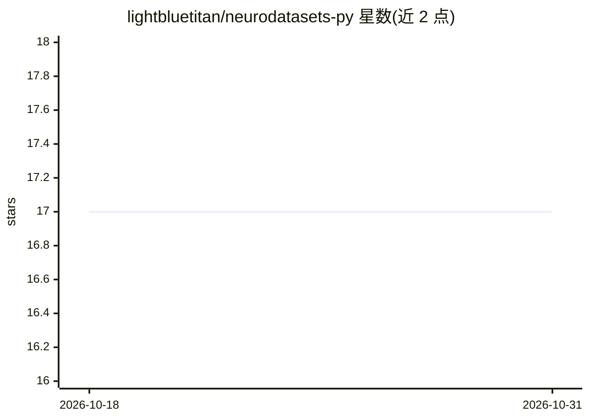

# lightbluetitan/neurodatasets-py

⭐ 17 · Python · GPL-3.0 · 推送 2026-07-21 · [GitHub](https://github.com/lightbluetitan/neurodatasets-py) · [官网](https://lightbluetitan.github.io/neurodatasets-py/) · 个人维护

**神经科学数据集 Python 包：供分析与机器学习研究使用**

以 Python 包形式提供来自 CRAN 上 R 包的神经科学与脑相关数据集合集，涵盖生物医学语音记录、MRI 脑成像、阿尔茨海默病与帕金森病生物标志物、癫痫发作、ADHD 症状、睡眠研究、PTSD、偏头痛治疗等。数据集保留原始许可与署名，通过 pip 安装，提供 list_datasets() 查看完整清单。声明仅限教育、研究用途，不承担数据准确性保证，临床决策须咨询专业医护人员。要求 Python 3.8+，库本身采用 GPL-3.0。

## 筛选速览

| 维度 | 判定 | 备注 |
|---|---|---|
| AI 角色 | `ai-knowledge` | 知识聚合/清单类 |
| 许可风险 | `viral` | GPL-3.0 |
| 部署形态 | `library` | 以包/库形式分发 |
| 模型依赖 | — | README 未给出锁定关系 |
| 硬件要求 | — | 无带数字的原话,不猜 |
| 安装摩擦 | `low` | 无编译、无系统依赖或容器化 |
| 成熟度 | — | 结构信号不足 |

## 能力要点

- 聚合 CRAN R 包来源的神经科学数据集
- 覆盖脑成像、疾病生物标志物、睡眠、认知等多主题
- 提供 list_datasets() 列出全部数据集
- 数据集保留原始许可与署名

## 适用场景

- 为统计分析或机器学习项目加载神经科学数据集
- 教学中演示脑相关数据的探索与可视化
- 快速查找阿尔茨海默、癫痫等主题的现成数据

## 场景标签

 · 领域:神经科学/数据集

## 证据(README 行号)

> L6: The `neurodatasets` package provides a curated collection of neuroscience and brain-related datasets
> L7: for data analysis, statistical modeling, and machine learning research. Includes biomedical voice recordings, MRI br

## 星数曲线

2026-10-18 17 → 2026-10-31 17（+0）

---
*卡片 v1 · prompt 1.4 · 生成 2026-10-29 · 置信度 high · 依据 README sha `d62946b5954d` · [字段定义](../../DATASET.md)*
