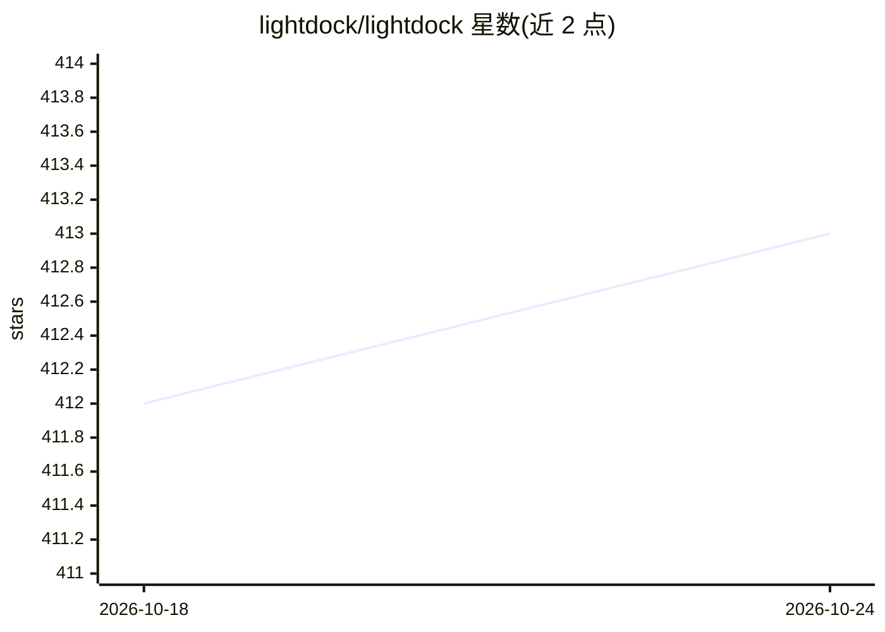

# lightdock/lightdock

⭐ 413 · Python · GPL-3.0 · 推送 2026-09-06 · [GitHub](https://github.com/lightdock/lightdock) · [官网](https://lightdock.org/) · 组织维护

**蛋白质-蛋白质/肽/DNA 对接模拟框架，基于萤火虫群优化算法**

LightDock 是一个分子对接框架，用 Glowworm Swarm Optimization（GSO）算法模拟蛋白质-蛋白质、蛋白质-肽与蛋白质-DNA 对接。支持用户自定义打分函数、无梯度局部最小化、从初始即约束模拟至指定相互作用区域，以及受体与配体两端的残基约束。兼容 macOS、多种 GNU/Linux 发行版与 Google Colab；Windows 非官方支持。协议与扩展已发表于 Bioinformatics、Nat Commun 与 NAR 等期刊，要求引用。通过 pip 安装，依赖 NumPy、SciPy、Cython、ProDy 与 Freesasa。

## 筛选速览

| 维度 | 判定 | 备注 |
|---|---|---|
| AI 角色 | `ai-native` | 本体是模型或模型工具 |
| 许可风险 | `viral` | GPL-3.0 |
| 部署形态 | `library` | 以包/库形式分发 |
| 模型依赖 | — | README 未给出锁定关系 |
| 硬件要求 | — | 无带数字的原话,不猜 |
| 安装摩擦 | `low` | 无编译、无系统依赖或容器化 |
| 成熟度 | — | 结构信号不足 |

## 能力要点

- 基于 GSO 算法的多尺度分子对接模拟
- 支持用户自定义打分函数与无梯度局部最小化
- 受体与配体两端均支持残基约束
- 依赖 NumPy/SciPy/Cython/ProDy/Freesasa，pip 安装

## 适用场景

- 预测蛋白质-蛋白质或蛋白质-肽复合物结构
- 蛋白质-DNA 相互作用的对接建模
- 在约束指定相互作用区域的条件下做对接模拟

## 场景标签

 · 领域:生物信息学/结构生物学

## 证据(README 行号)

> L8: **LightDock** is a protein-protein, protein-peptide and protein-DNA docking framework based on the Glowworm Swarm Op
> L10: The LightDock framework is highly versatile, with many options that can be further developed and optimized by the u

## 星数曲线

2026-10-18 412 → 2026-10-24 413（+1）

---
*卡片 v1 · prompt 1.4 · 生成 2026-10-21 · 置信度 high · 依据 README sha `26519e215869` · [字段定义](../../DATASET.md)*
