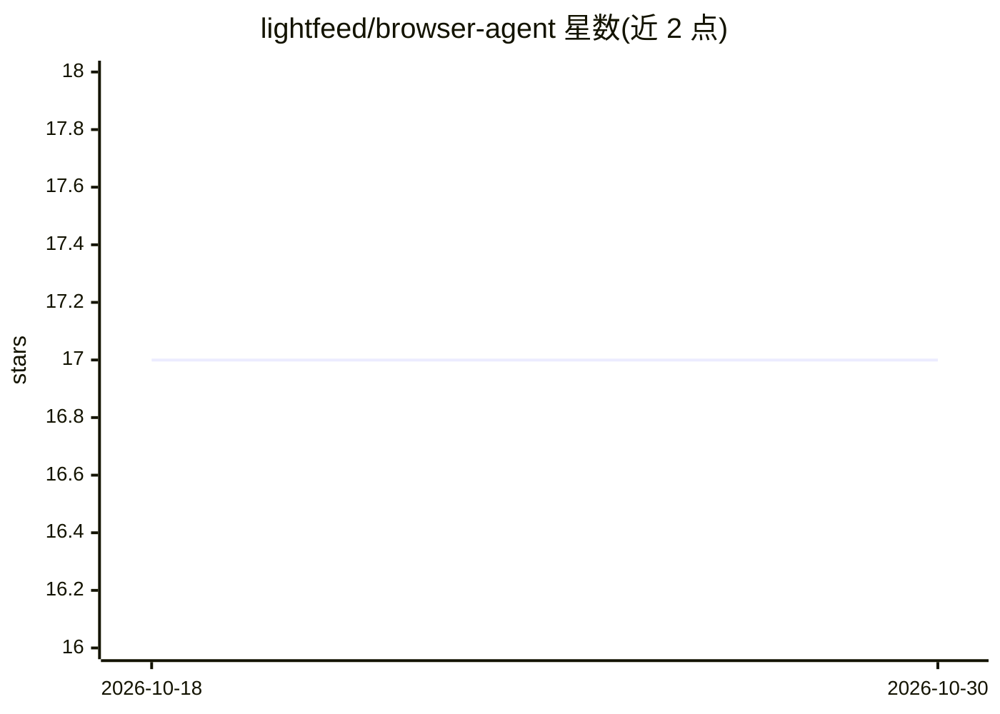

# lightfeed/browser-agent

⭐ 17 · TypeScript · MIT · 推送 2026-04-24 · [GitHub](https://github.com/lightfeed/browser-agent) · 组织维护

**可重放的浏览器代理库：AI 导航一次，之后零 token 重放**

TypeScript 浏览器代理库，面向需要反复执行相同网页导航的自动化/抓取场景。AI 驱动浏览器完成导航后，保存为含 xpath/cssPath 的 JSON 计划，后续 replay 无 LLM 调用、无截图、无 DOM 映射，仅对动态数据部分用 .extract() 消耗少量 token；DOM 漂移时 aiFallback 仅对失败步骤重新规划。支持 Local/Remote(CDP)/Serverless(AWS Lambda + @sparticuz/chromium) 三种浏览器后端，同一 API 可切换。提供 npm 库与 CLI（browser-agent-cli），LLM 从 Google/OpenAI/Anthropic 环境变量自动检测。限制：计划中记录的 output 不会在程序化 replay 时重新生成；Playwright 版本需与 @sparticuz/chromium 版本匹配。

## 筛选速览

| 维度 | 判定 | 备注 |
|---|---|---|
| AI 角色 | `ai-ecosystem` | LLM/agent 周边工具 |
| 许可风险 | `permissive` | MIT |
| 部署形态 | `library` | 以包/库形式分发 |
| 模型依赖 | — | README 未给出锁定关系 |
| 硬件要求 | — | 无带数字的原话,不猜 |
| 安装摩擦 | `low` | 无编译、无系统依赖或容器化 |
| 成熟度 | — | 结构信号不足 |

## 能力要点

- AI 导航一次后以 JSON 计划零 token 重放
- aiFallback 仅对 DOM 漂移的单个步骤重新规划
- 同一 API 支持 Local / Remote CDP / AWS Lambda 三种浏览器后端
- 提供 CLI（browser-agent-cli），LLM 从环境变量自动检测

## 适用场景

- 定时抓取结构稳定的页面，节省每次导航的 LLM token
- 把同一计划重定向到不同 URL（staging/预发布/不同查询）
- 在 AWS Lambda 上运行计划任务式浏览器自动化
- 录制一次流程后手工编辑计划中的输入值或步骤顺序

## 场景标签

`浏览器自动化` `网页抓取` · 领域:效率与自动化

## 证据(README 行号)

> L3:  TypeScript browser agent library. AI drives the browser once — replay the navigation with zero LLM tokens.
> L14: `@lightfeed/browser-agent` is a TypeScript browser agent library built for cutting LLM token use on every rerun.
> L21: **This library lets you run navigation once with AI, save it as a plan, and replay it with zero LLM calls** — no sc

## 星数曲线

2026-10-18 17 → 2026-10-30 17（+0）

---
*卡片 v1 · prompt 1.4 · 生成 2026-10-29 · 置信度 high · 依据 README sha `b09a543b4ecd` · [字段定义](../../DATASET.md)*
