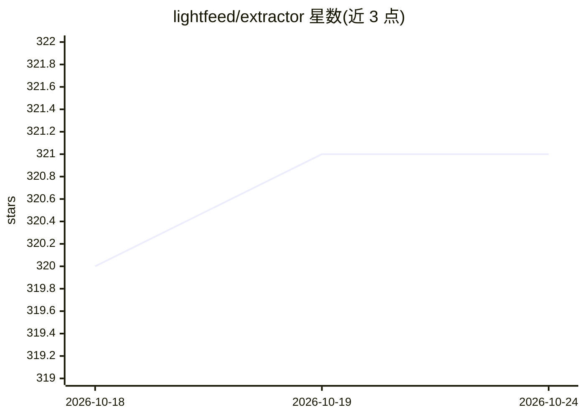

# lightfeed/extractor

⭐ 321 · TypeScript · Apache-2.0 · 推送 2026-06-06 · [GitHub](https://github.com/lightfeed/extractor) · [官网](https://lightfeed.ai) · 组织维护

**给开发者的 TypeScript 库：用 LLM 从网页提取结构化数据**

基于 LangChain 的 TypeScript 网页数据提取库：将 HTML/Markdown/纯文本输入 LLM 的 JSON 模式，按 Zod schema 产出结构化数据；提供 HTML 转 Markdown、主内容启发式提取、URL 清理（当前支持 Amazon 链接）、失败 JSON 修复、token 用量追踪与 maxInputTokens 截断。可搭配 Playwright 加载页面、@lightfeed/browser-agent 做自然语言导航。需自选 LangChain 聊天模型（OpenAI/Gemini/Anthropic/Ollama 等）并配置 API key。限制：OpenAI 模型不支持 optional schema，需改用 .nullable()。

## 筛选速览

| 维度 | 判定 | 备注 |
|---|---|---|
| AI 角色 | `ai-ecosystem` | LLM/agent 周边工具 |
| 许可风险 | `permissive` | Apache-2.0 |
| 部署形态 | `library` | 以包/库形式分发 |
| 模型依赖 | local-ok | 支持本地模型 |
| 硬件要求 | — | 无带数字的原话,不猜 |
| 安装摩擦 | `low` | 无编译、无系统依赖或容器化 |
| 成熟度 | — | 结构信号不足 |

## 能力要点

- LLM JSON 模式按 Zod schema 提取结构化数据，含 token 限制与追踪
- HTML→LLM-ready Markdown 转换（主内容提取、去跟踪参数、数字类名标注）
- 失败 JSON 的清洗与恢复，支持深层嵌套结构
- 可配合 Playwright 与 @lightfeed/browser-agent 组成导航+提取流水线

## 适用场景

- 从电商页面提取商品价格、评分等结构化字段
- 把博客/文章 HTML 转成干净 Markdown 喂给 LLM
- 对需要交互（搜索、翻页）的页面先导航后提取数据

## 场景标签

`网页抓取` `文档解析` · 领域:效率与自动化

## 证据(README 行号)

> L17: Lightfeed Extractor is a Typescript library built for robust web data extraction using LLMs. Use natural language p
> L38: Install the extractor along with `@langchain/core` and your chosen LLM provider:
> L44: Then add your LLM provider (we use LangChain for interoperability):

## 星数曲线

2026-10-18 320 → 2026-10-24 321（+1）

---
*卡片 v1 · prompt 1.4 · 生成 2026-10-21 · 置信度 high · 依据 README sha `6063fe658d68` · [字段定义](../../DATASET.md)*
