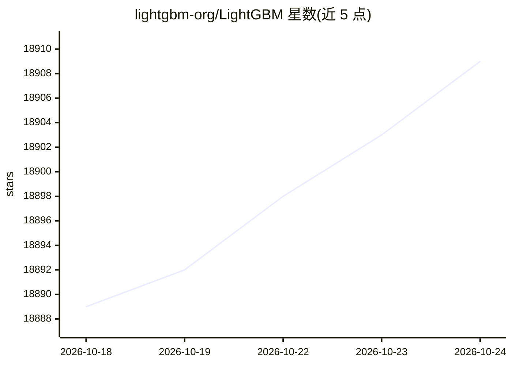

# lightgbm-org/LightGBM

⭐ 18,911 · C++ · MIT · 推送 2026-10-24 · [GitHub](https://github.com/lightgbm-org/LightGBM) · [官网](https://lightgbm.readthedocs.io/en/latest/) · 组织维护

**机器学习用户：基于决策树的分布式梯度提升框架**

LightGBM 是基于决策树算法的梯度提升框架（GBT/GBDT/GBRT/GBM/MART），用于排序、分类等机器学习任务。支持并行、分布式与 GPU 训练，可处理大规模数据。官方提供 Python、R 包，以及 CUDA 版本和 SWIG 封装，并通过 PyPI、conda、CRAN、NuGet、Winget 等渠道分发。文档托管于 readthedocs，另收录数十个非官方生态项目（PMML 转换、Spark/Kubernetes 集成、各语言绑定、可解释性与可视化工具等）。

## 筛选速览

| 维度 | 判定 | 备注 |
|---|---|---|
| AI 角色 | `ai-ecosystem` | LLM/agent 周边工具 |
| 许可风险 | `permissive` | MIT |
| 部署形态 | `desktop` | 安装包/桌面程序 |
| 模型依赖 | — | README 未给出锁定关系 |
| 硬件要求 | — | 无带数字的原话,不猜 |
| 安装摩擦 | `medium` | 含编译或系统依赖之一 |
| 成熟度 | — | 结构信号不足 |

## 动量与使用信号

- 维护:`active` — 距上次 push 1.2 天,年发版 1,345 位贡献者
- 涨星:近 1 天 **+4**(自 20261016 起算)

## 能力要点

- 基于决策树的梯度提升框架，用于排序、分类等任务
- 支持并行、分布式与 GPU 学习，可处理大规模数据
- 官方提供 Python/R 包及 CUDA、SWIG 构建，多渠道分发
- 收录大量第三方生态：Spark/K8s 集成、多语言绑定、模型转换与可解释工具

## 适用场景

- 大规模数据的分类、排序等表格机器学习任务
- 多机分布式训练加速模型迭代
- 参加 Kaggle 等机器学习竞赛
- 在 Spark/Ray/Kubernetes 等平台上运行梯度提升训练

## 场景标签

 · 领域:机器学习框架

## 证据(README 行号)

> L27: LightGBM is a gradient boosting framework that uses tree based learning algorithms. It is designed to be distribute
> L32: - Support of parallel, distributed, and GPU learning.

## 星数曲线

2026-10-18 18,889 → 2026-10-24 18,909（+20）

---
*卡片 v1 · prompt 1.4 · 生成 2026-10-18 · 置信度 high · 依据 README sha `16b9e3aa1f36` · [字段定义](../../DATASET.md)*
