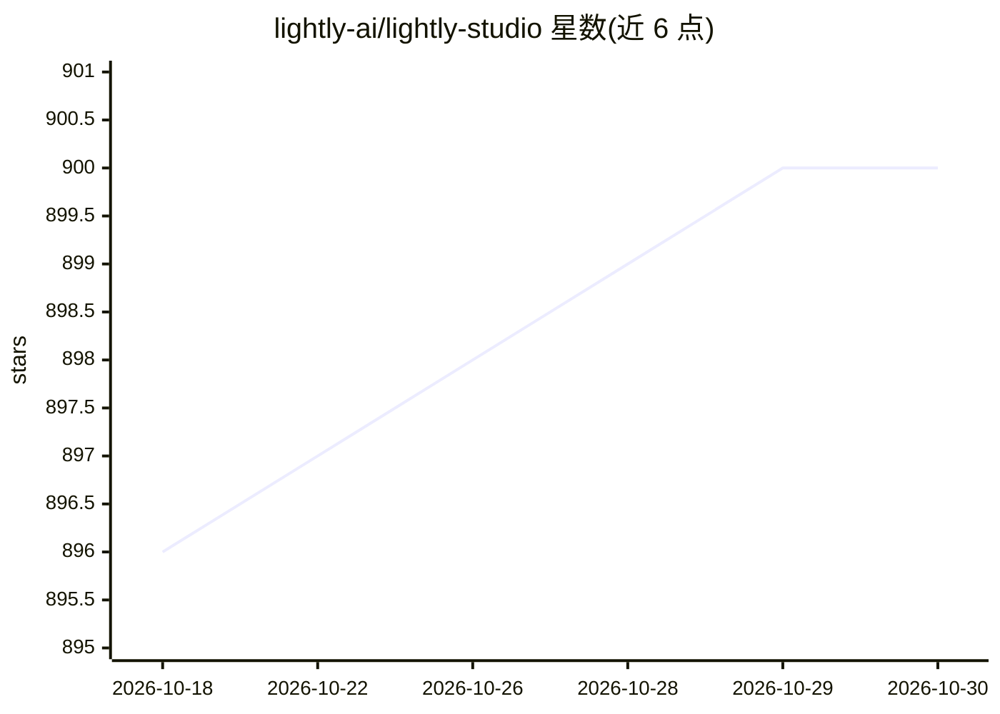

# lightly-ai/lightly-studio

⭐ 900 · Python · Apache-2.0 · 推送 2026-10-29 · [GitHub](https://github.com/lightly-ai/lightly-studio) · [官网](https://docs.lightly.ai/studio/) · 组织维护

**多模态 ML 的本地数据管理平台：图像/视频集策展与标注**

LightlyStudio 是在本地运行、浏览器中打开的数据平台：用 Python 脚本将图像文件夹、COCO、YOLO 数据集或视频索引进本地数据库，支持嵌入可视化、套索聚类筛选、查询过滤、采样（挑选典型且多样的样本以降低标注成本）、标注编辑与模型评估（预测对真值、混淆矩阵）。提供插件机制，可用 SAM 等模型自动标注；结果可导出为 COCO 或 YOLO。README 称在单台 MacBook（M1、16GB RAM）上可处理 200 万+图像。面向计算机视觉与 MLOps 从业者。

## 筛选速览

| 维度 | 判定 | 备注 |
|---|---|---|
| AI 角色 | `ai-ecosystem` | LLM/agent 周边工具 |
| 许可风险 | `permissive` | Apache-2.0 |
| 部署形态 | `library` | 以包/库形式分发 |
| 模型依赖 | — | README 未给出锁定关系 |
| 硬件要求 | — | 无带数字的原话,不猜 |
| 安装摩擦 | `low` | 无编译、无系统依赖或容器化 |
| 成熟度 | — | 结构信号不足 |

## 能力要点

- 索引图像/视频/COCO/YOLO 数据集并本地浏览管理，数据不离开本机
- 嵌入可视化与聚类筛选、Lightly Query Language 查询过滤
- 采样功能挑选典型且多样样本以降低标注成本
- 插件自动标注（SAM 等）与模型评估（混淆矩阵、失败模式分析）

## 适用场景

- 管理大规模图像/视频数据集并做标注审核
- 用嵌入与聚类剔除近似重复、挑选待标注样本
- 评估 YOLO 等检测模型预测并导出问题样本重新标注

## 场景标签

`图像视频处理` `MLOps` · 领域:感知与多模态

## 证据(README 行号)

> L126: - **Curate a Traffic CCTV Dataset for YOLO Training:** Explore embeddings, remove near-duplicates, auto-label with
> L144: - Sampling — pick the most typical and diverse samples to cut labeling cost
> L146: - Plugins — auto-label with SAM and other models

## 星数曲线

2026-10-18 896 → 2026-10-30 900（+4）

---
*卡片 v1 · prompt 1.4 · 生成 2026-10-21 · 置信度 high · 依据 README sha `101aaa92b7f8` · [字段定义](../../DATASET.md)*
