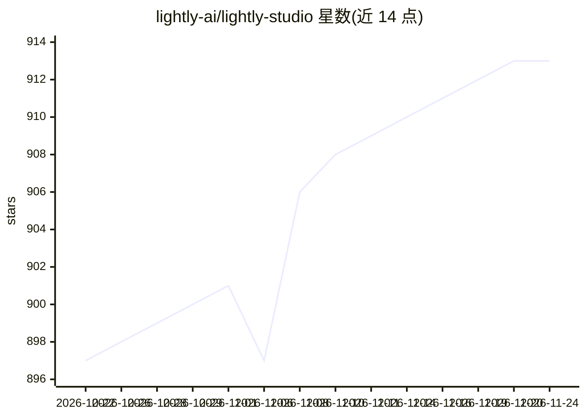

# lightly-ai/lightly-studio

⭐ 913 · Python · Apache-2.0 · 推送 2026-11-23 · [GitHub](https://github.com/lightly-ai/lightly-studio) · [官网](https://docs.lightly.ai/studio/) · 组织维护

**给 ML 团队的多模态数据管理与标注平台**

LightlyStudio 是一个在本地运行、浏览器打开的多模态 ML 数据平台：用 Python 脚本把图像/视频/COCO/YOLO 数据索引进本地数据库，支持 S3/GCS/Azure 云存储读取；提供嵌入图聚类浏览、查询过滤（Lightly Query Language）、标注编辑、采样去重以减少标注量、模型评估对比预测与真值，并可通过插件用 SAM 等模型自动标注；支持导出 COCO/YOLO，全流程可通过 Python API 脚本化，在 Jupyter/Colab 中运行 GUI。

## 筛选速览

| 维度 | 判定 | 备注 |
|---|---|---|
| AI 角色 | `ai-enhanced` | 去掉 AI 部分产品仍成立 |
| 许可风险 | `permissive` | Apache-2.0 |
| 部署形态 | `library` | 以包/库形式分发 |
| 模型依赖 | — | README 未给出锁定关系 |
| 硬件要求 | — | 无带数字的原话,不猜 |
| 安装摩擦 | `low` | 无编译、无系统依赖或容器化 |
| 成熟度 | — | 结构信号不足 |

## 能力要点

- 本地运行，图像与数据集不离开本机（L41）
- 嵌入图可视化与聚类筛选（L27-29）
- 采样挑选典型且多样的样本以降低标注成本（L144）
- 插件支持用 SAM 等模型自动标注（L146）

## 适用场景

- 为 YOLO 训练整理交通监控图像数据集，去除近重复样本
- 在浏览器中对图像/视频数据进行标注与复核
- 对比模型预测与真值，找出失败模式并导出重标
- 从 S3/GCS/Azure 云存储索引图像建立本地数据集

## 场景标签

`MLOps` · 领域:训练与推理

## 证据(README 行号)

> L19:  Curate, Annotate, and Manage Your Data in LightlyStudio.
> L34: LightlyStudio runs on your computer and opens in your browser. The following command downloads an example dataset w
> L146: - Plugins — auto-label with SAM and other models

## 星数曲线

2026-10-22 897 → 2026-11-24 913（+16）

---
*卡片 v1 · prompt 1.4 · 生成 2026-11-24 · 置信度 high · 依据 README sha `47d3466d4137` · [字段定义](../../DATASET.md)*
