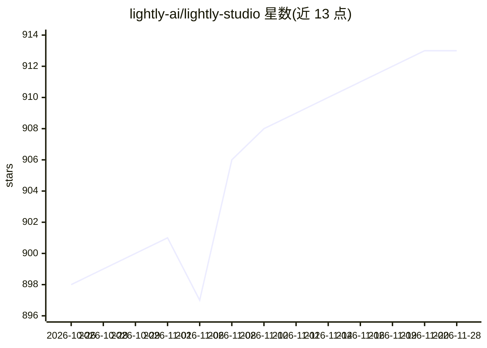

# lightly-ai/lightly-studio

⭐ 913 · Python · Apache-2.0 · 推送 2026-11-27 · [GitHub](https://github.com/lightly-ai/lightly-studio) · [官网](https://docs.lightly.ai/studio/) · 组织维护

**面向多模态 ML 团队的图像数据管理与标注平台**

本地运行的浏览器端数据平台，覆盖计算机视觉数据集的整理、标注、查询与导出：支持索引图像/视频文件夹及 COCO、YOLO 格式，读取 S3/GCS/Azure 云存储，提供嵌入图聚类筛选、采样去重、标注编辑器、预测与真值对比评估，并可导出 COCO/YOLO。通过 pip 安装，Python 脚本索引数据后启动本地服务，数据不离开本机；可在 2M+ 图像规模下于单台 MacBook 运行。

## 筛选速览

| 维度 | 判定 | 备注 |
|---|---|---|
| AI 角色 | `ai-ecosystem` | LLM/agent 周边工具 |
| 许可风险 | `permissive` | Apache-2.0 |
| 部署形态 | `library` | 以包/库形式分发 |
| 模型依赖 | — | README 未给出锁定关系 |
| 硬件要求 | — | 无带数字的原话,不猜 |
| 安装摩擦 | `low` | 无编译、无系统依赖或容器化 |
| 成熟度 | — | 结构信号不足 |

## 能力要点

- 嵌入图聚类选择过滤图像网格，支持悬停预览与文本搜索
- 采样挑选典型与多样样本以降低标注成本
- Plugins 支持用 SAM 等模型自动标注
- 模型评估：预测与真值对比、混淆矩阵、问题导出重标

## 适用场景

- 训练 YOLO 模型前整理去重 CCTV 图像数据集
- 用 SAM 插件自动标注后人工审核修正
- 对比模型预测与真值，定位失败模式并导出重标
- 在 Jupyter/Colab 中以 notebook 方式管理数据集

## 场景标签

`目标检测` `MLOps` · 领域:感知与多模态

## 证据(README 行号)

> L19:  Curate, Annotate, and Manage Your Data in LightlyStudio.
> L146: - Model evaluation — compare predictions against ground truth
> L147: - Plugins — auto-label with SAM and other models

## 星数曲线

2026-10-26 898 → 2026-11-28 913（+15）

---
*卡片 v1 · prompt 1.4 · 生成 2026-11-28 · 置信度 high · 依据 README sha `e41dbb9ed8e1` · [字段定义](../../DATASET.md)*
