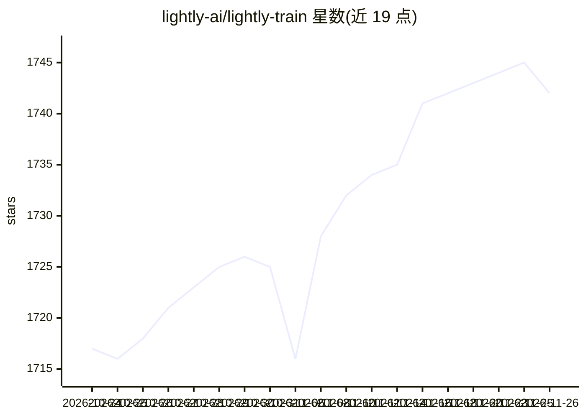

# lightly-ai/lightly-train

⭐ 1,742 · Python · AGPL-3.0 · 推送 2026-11-12 · [GitHub](https://github.com/lightly-ai/lightly-train) · [官网](https://docs.lightly.ai/train) · 组织维护

**视觉模型训练框架：预训练/微调/蒸馏检测分割深度模型**

Python 训练框架，覆盖视觉模型开发生命周期：在无标注数据上预训练 DINOv2/v3 类基础模型，微调 LTDETR/DINOv3/EoMT 系列做目标检测、实例/语义/全景分割、图像分类，并用 DINOv2/v3 蒸馏将知识迁移到 YOLOv8/v11、RT-DETR 等任意架构；另提供 Depth Anything 系列的单目深度推理。各任务给出 COCO/Cityscapes 基准表与 TensorRT/ONNX 导出路径。pip 安装，支持 Windows/Linux/macOS，Python 3.8+；商业使用需联系获取商业许可。

## 筛选速览

| 维度 | 判定 | 备注 |
|---|---|---|
| AI 角色 | `ai-native` | 本体是模型或模型工具 |
| 许可风险 | `dual` | AGPL-3.0 |
| 部署形态 | `library` | 以包/库形式分发 |
| 模型依赖 | — | README 未给出锁定关系 |
| 硬件要求 | — | 无带数字的原话,不猜 |
| 安装摩擦 | `low` | 无编译、无系统依赖或容器化 |
| 成熟度 | — | 结构信号不足 |

## 能力要点

- 无标注数据上预训练 DINOv2/v3 基础模型
- 蒸馏 DINOv2/v3 权重到任意架构（YOLO、RT-DETR、Faster R-CNN）
- LTDETRv2/EoMT 检测与分割模型训练，支持 ONNX/TensorRT 导出
- Depth Anything V2/V3 单目深度推理与自蒸馏小模型

## 适用场景

- 在自有无标注数据上做视觉预训练提升下游检测精度
- 训练边缘部署用的小参数量检测/分割模型
- 用蒸馏把基础模型知识迁移到 YOLO 等生产模型
- 部署单目深度估计推理

## 场景标签

`模型训练` `微调` `目标检测` · 领域:感知与多模态

## 证据(README 行号)

> L16: LightlyTrain is the leading framework for transforming your data into state-of-the-art
> L19: transformer and YOLO models on detection and segmentation tasks for edge deployment.
> L88: pip install lightly-train

## 星数曲线

2026-10-24 1,717 → 2026-11-26 1,742（+25）

---
*卡片 v1 · prompt 1.4 · 生成 2026-11-23 · 置信度 high · 依据 README sha `c535e84926fc` · [字段定义](../../DATASET.md)*
