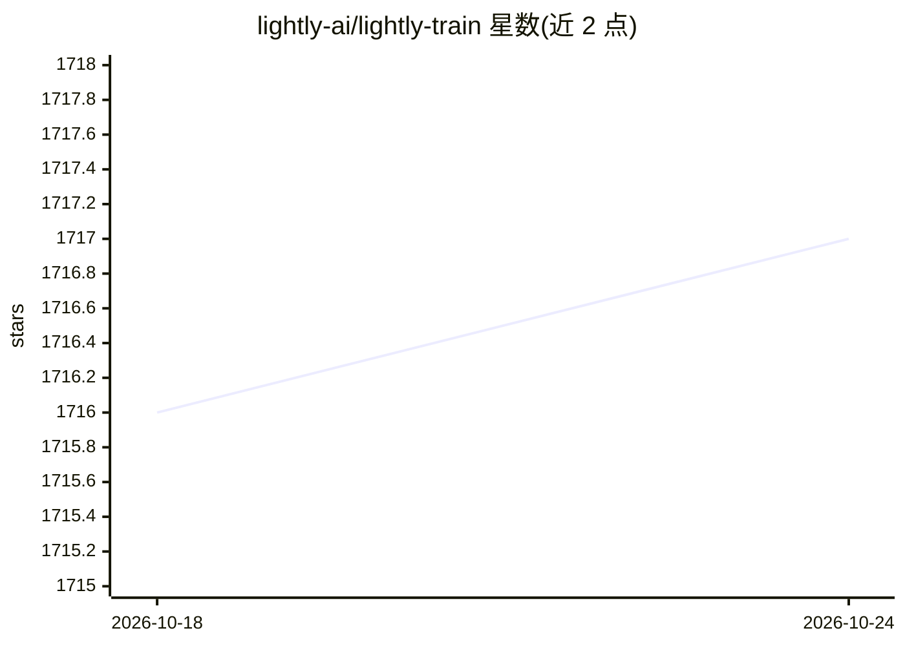

# lightly-ai/lightly-train

⭐ 1,716 · Python · AGPL-3.0 · 推送 2026-10-24 · [GitHub](https://github.com/lightly-ai/lightly-train) · [官网](https://docs.lightly.ai/train) · 组织维护

**面向视觉模型的预训练、微调与蒸馏一体化训练框架**

Lightly 公司维护的计算机视觉训练框架，覆盖模型开发全流程：在无标注数据上预训练 DINOv2/v3 视觉基础模型、从 DINOv2/v3 蒸馏到任意架构（YOLO、RT-DETR、Faster R-CNN 等）、以及在检测/分割/分类任务上微调，另提供 Depth Anything V2/V3 深度估计推理与基于预训练模型的自标注命令。给出 COCO、COCO-Stuff、Cityscapes、ImageNet-1K 等基准结果，支持 ONNX/TensorRT FP16 导出。通过 pip 安装，Python 3.8+，Windows/Linux/macOS；商业用途需联系获取 Commercial License。

## 筛选速览

| 维度 | 判定 | 备注 |
|---|---|---|
| AI 角色 | `ai-native` | 本体是模型或模型工具 |
| 许可风险 | `dual` | AGPL-3.0 |
| 部署形态 | `library` | 以包/库形式分发 |
| 模型依赖 | — | README 未给出锁定关系 |
| 硬件要求 | — | 无带数字的原话,不猜 |
| 安装摩擦 | `low` | 无编译、无系统依赖或容器化 |
| 成熟度 | — | 结构信号不足 |

## 能力要点

- DINOv2/v3 预训练与知识蒸馏（含自定义教师模型）
- 目标检测/实例分割/语义分割/全景分割/分类的微调训练
- Depth Anything V2/V3 单目深度推理（含自蒸馏小模型）
- ONNX/TensorRT FP16 导出与自标注命令

## 适用场景

- 用自有无标注图像预训练或蒸馏视觉基础模型
- 为边缘部署微调检测与分割模型并导出 TensorRT
- 用预训练模型为无标注图像自动打标以扩充训练集

## 场景标签

`模型训练` `微调` · 领域:训练与推理

## 证据(README 行号)

> L16: LightlyTrain is the leading framework for transforming your data into state-of-the-art
> L18: pretraining DINOv2/v3 vision foundation models on your unlabeled data to fine-tuning

## 星数曲线

2026-10-18 1,716 → 2026-10-24 1,717（+1）

---
*卡片 v1 · prompt 1.4 · 生成 2026-10-21 · 置信度 high · 依据 README sha `53963aaf4206` · [字段定义](../../DATASET.md)*
