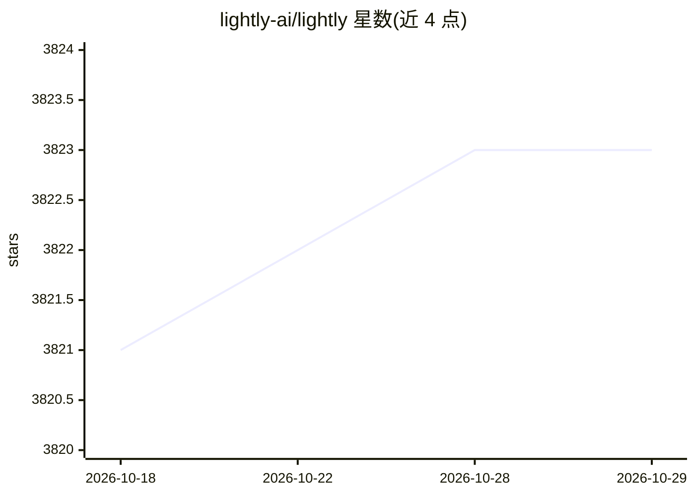

# lightly-ai/lightly

⭐ 3,823 · Python · MIT · 推送 2026-10-28 · [GitHub](https://github.com/lightly-ai/lightly) · [官网](https://docs.lightly.ai/self-supervised-learning/) · 组织维护

**图像自监督学习框架：在自有数据上预训练视觉模型**

基于 PyTorch 的计算机视觉自监督学习 Python 库，模块化暴露损失函数、模型头等底层组件，支持自定义骨干网络与通过 PyTorch Lightning 的分布式多 GPU 训练。内置 20 余种 SSL 方法（MoCo、SimCLR、DINO、MAE、DINOv2、LeJEPA 等），每个方法提供 PyTorch 与 Lightning 的 Colab 示例，并公开 ImageNet1k 等基准结果与 checkpoint。面向研究者和视觉任务开发者，要求 Python 3.8+（暂不支持 3.13），由公司维护并声明框架永久免费商用，另有商业版 LightlyStudio/平台。

## 筛选速览

| 维度 | 判定 | 备注 |
|---|---|---|
| AI 角色 | `ai-native` | 本体是模型或模型工具 |
| 许可风险 | `permissive` | MIT |
| 部署形态 | `library` | 以包/库形式分发 |
| 模型依赖 | — | README 未给出锁定关系 |
| 硬件要求 | — | 无带数字的原话,不猜 |
| 安装摩擦 | `medium` | 含编译或系统依赖之一 |
| 成熟度 | — | 结构信号不足 |

## 能力要点

- 内置 20 余种自监督方法（MoCo/SimCLR/DINO/MAE/DINOv2/LeJEPA 等）
- 模块化组件：损失函数、模型头、自定义骨干均可替换
- 基于 PyTorch Lightning 的分布式多 GPU 训练（同步 BatchNorm）
- 公开 ImageNet1k 等基准成绩、脚本与 checkpoint

## 适用场景

- 在自有无标注图像数据上预训练视觉骨干模型
- 复现或对比各类自监督学习方法
- 下游检测/分类任务前先用 SSL 预训练再微调

## 场景标签

`模型训练` · 领域:训练与推理

## 证据(README 行号)

> L11: Lightly**SSL** is a computer vision framework for self-supervised learning.
> L53: |Model|Year|Paper|Docs|Colab (PyTorch)|Colab (PyTorch Lightning)|
> L103: - PyTorch>=1.11.0

## 星数曲线

2026-10-18 3,821 → 2026-10-29 3,823（+2）

---
*卡片 v1 · prompt 1.4 · 生成 2026-10-20 · 置信度 high · 依据 README sha `418be4d3bc0f` · [字段定义](../../DATASET.md)*
