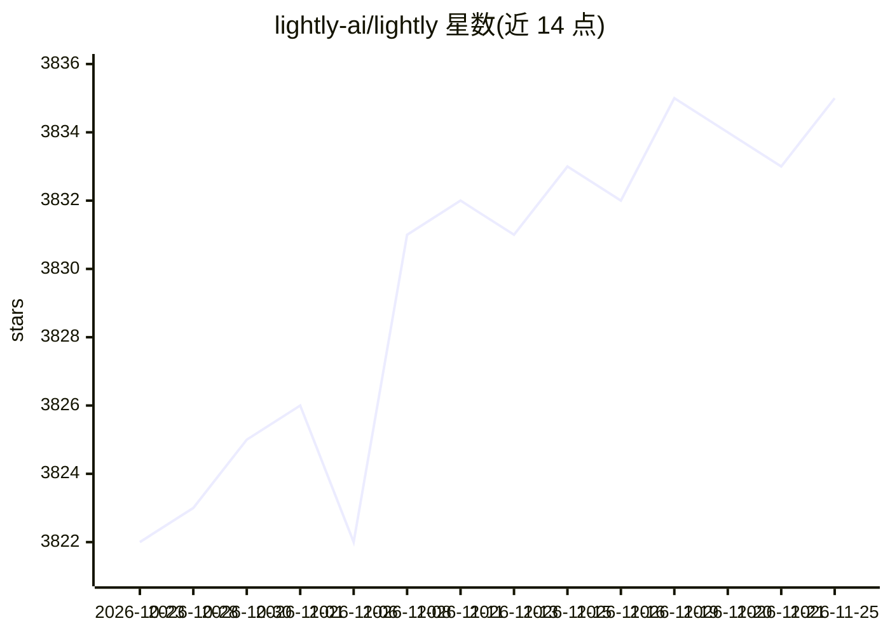

# lightly-ai/lightly

⭐ 3,835 · Python · MIT · 推送 2026-11-10 · [GitHub](https://github.com/lightly-ai/lightly) · [官网](https://docs.lightly.ai/self-supervised-learning/) · 组织维护

**图像自监督学习与潜在世界模型的 PyTorch 框架**

LightlySSL 是面向计算机视觉的自监督学习框架，提供 MoCo、SimCLR、DINO、MAE、LeJEPA 等 20 余种模型实现以及世界模型 LeWM，暴露损失函数、模型头等低层组件，支持自定义 backbone 与基于 PyTorch Lightning 的分布式训练，并给出 ImageNet 等数据集的基准结果与 Colab 示例。面向需要在自己数据上做表征预训练的研究者与开发者。限制：要求 Python 3.8+（不支持 3.13），推荐 Linux/OSX 环境；Docker 支持等更多功能位于商业版本。

## 筛选速览

| 维度 | 判定 | 备注 |
|---|---|---|
| AI 角色 | `ai-native` | 本体是模型或模型工具 |
| 许可风险 | `permissive` | MIT |
| 部署形态 | `library` | 以包/库形式分发 |
| 模型依赖 | — | README 未给出锁定关系 |
| 硬件要求 | — | 无带数字的原话,不猜 |
| 安装摩擦 | `medium` | 含编译或系统依赖之一 |
| 成熟度 | — | 结构信号不足 |

## 能力要点

- 实现 20+ 自监督学习模型（MoCo/SimCLR/DINO/MAE/LeJEPA 等），附论文、文档与 Colab
- 提供世界模型 LeWM：从原始帧与动作学习并用其规划
- 模块化设计，支持自定义 backbone 与 PyTorch Lightning 分布式多 GPU 训练
- 提供 ImageNet1k/100、CIFAR-10 等基准与 checkpoint 下载

## 适用场景

- 在自己的图像数据集上训练自监督预训练表征
- 复现或对比 SSL 论文方法并查看基准指标
- 为检测/分割任务预训练 Detectron2 或 timm backbone
- 训练世界模型并用于规划任务

## 场景标签

`模型训练` · 领域:训练与推理

## 证据(README 行号)

> L11: Lightly**SSL** is a computer vision framework for self-supervised learning and latent world models.
> L63: - Supports custom backbone models for self-supervised pre-training.

## 星数曲线

2026-10-23 3,822 → 2026-11-25 3,835（+13）

---
*卡片 v1 · prompt 1.4 · 生成 2026-11-23 · 置信度 high · 依据 README sha `e4bffb461bce` · [字段定义](../../DATASET.md)*
