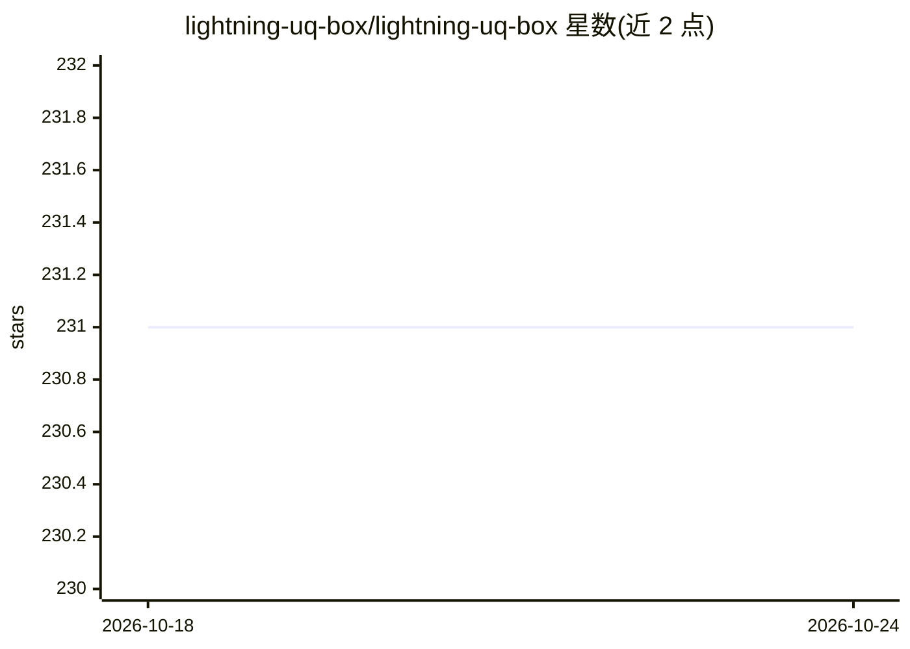

# lightning-uq-box/lightning-uq-box

⭐ 231 · Python · Apache-2.0 · 推送 2026-10-22 · [GitHub](https://github.com/lightning-uq-box/lightning-uq-box) · [官网](https://lightning-uq-box.readthedocs.io/en/latest/) · 组织维护

**基于 PyTorch Lightning 的神经网络不确定性量化方法库**

PyTorch 库，提供多种神经网络不确定性量化（UQ）方法实现，覆盖单次前向传播、近似贝叶斯、生成式与后处理四大类约 30 种方法（如 MC-Dropout、Deep Ensemble、Laplace、Conformal QR），支持回归、分类、分割与像素级回归任务组合。每个 UQ 方法即一个 Lightning Module，可配合 DataModule 与 Trainer 执行训练、评估与推理，并使用 Lightning CLI 保障实验可复现。通过 pip 安装，附 Theory Guide、教程（可运行于 Google Colab）与 JMLR 论文。项目自述处于活跃开发阶段。

## 筛选速览

| 维度 | 判定 | 备注 |
|---|---|---|
| AI 角色 | `ai-ecosystem` | LLM/agent 周边工具 |
| 许可风险 | `permissive` | Apache-2.0 |
| 部署形态 | `library` | 以包/库形式分发 |
| 模型依赖 | — | README 未给出锁定关系 |
| 硬件要求 | — | 无带数字的原话,不猜 |
| 安装摩擦 | `low` | 无编译、无系统依赖或容器化 |
| 成熟度 | `idea` | |

## 能力要点

- 四大类约 30 种 UQ 方法，按任务类型标注支持状态
- 每个 UQ 方法即 Lightning Module，配合 CLI 实现低样板代码的实验复现
- 提供 Theory Guide（数学细节）与可运行于 Google Colab 的教程
- 发布于 JMLR 的配套论文可引用

## 适用场景

- 在回归/分类/分割任务中为神经网络添加不确定性估计
- 在同一数据集上对比不同 UQ 方法的效果
- 按标准化评估协议复现 UQ 实验

## 场景标签

 · 领域:机器学习/不确定性量化

## 证据(README 行号)

> L13: The lightning-uq-box is a PyTorch library that provides various Uncertainty Quantification (UQ) techniques for mode
> L26: To this end, each UQ-Method is essentially just a Lightning Module which can be used with a Lightning Data Module a

## 星数曲线

2026-10-18 231 → 2026-10-24 231（+0）

---
*卡片 v1 · prompt 1.4 · 生成 2026-10-22 · 置信度 high · 依据 README sha `50ce8b94db03` · [字段定义](../../DATASET.md)*
