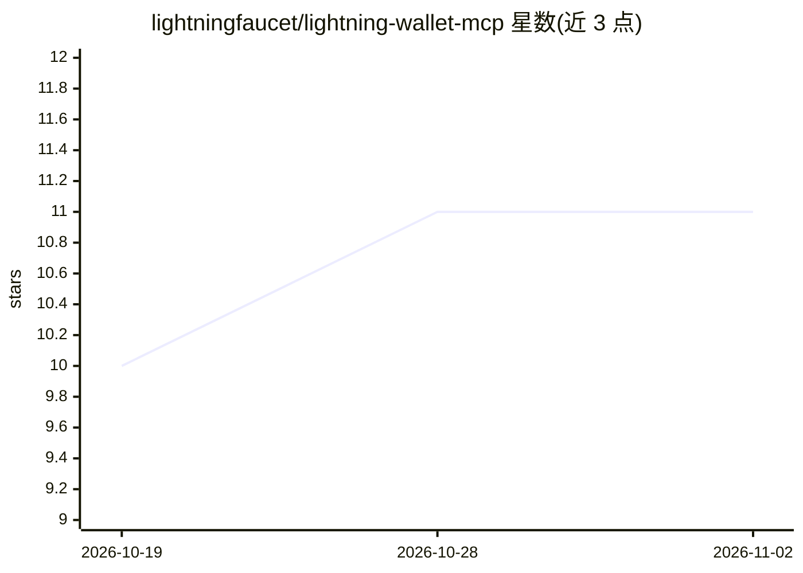

# lightningfaucet/lightning-wallet-mcp

⭐ 11 · TypeScript · MIT · 推送 2026-10-30 · [GitHub](https://github.com/lightningfaucet/lightning-wallet-mcp) · [官网](https://lightningfaucet.com/ai-agents/) · 组织维护

**给 AI agent 配比特币闪电钱包的 MCP Server 与 CLI**

面向 AI agent 的托管式比特币闪电网络钱包：以 MCP Server 加 CLI 形式提供，agent 可通过自然语言工具调用支付 L402/X402 API、支付任意闪电发票或闪电地址、收款与持有 sats。托管模式，无需运行节点或管理通道。提供 46 个工具，覆盖支付、收款、操作员账户、可选的独立 agent 预算与消费限额、webhook、L402 网关售卖自有 API，以及赛事与预测市场功能。兼容 Claude Code、Cursor、Windsurf 等 MCP 宿主，也提供远程 HTTP 端点。

## 筛选速览

| 维度 | 判定 | 备注 |
|---|---|---|
| AI 角色 | `ai-ecosystem` | LLM/agent 周边工具 |
| 许可风险 | `permissive` | MIT |
| 部署形态 | `library` | 以包/库形式分发 |
| 模型依赖 | — | README 未给出锁定关系 |
| 硬件要求 | — | 无带数字的原话,不猜 |
| 安装摩擦 | `low` | 无编译、无系统依赖或容器化 |
| 成熟度 | — | 结构信号不足 |

## 能力要点

- 46 个工具覆盖支付（BOLT11/闪电地址/keysend/nostr zap）、收款与账户管理
- 自动检测并支付 L402/X402 计费 API
- 可选 per-agent 密钥、预算与分级消费限额（单笔/每日/单市场/亏损上限）
- 支持通过 L402 网关将自有 API 挂付费墙出售

## 适用场景

- 让我的 AI agent 自动为 L402/X402 计费 API 付费并调用
- 通过对话让 agent 支付闪电发票、给闪电地址转账或收款
- 为多个 agent 设置独立密钥与预算、限额做支出控制

## 场景标签

 · 领域:加密货币/AI agent 基础设施

## 证据(README 行号)

> L7: **Give your AI agent a Bitcoin wallet.** One MCP server plus a CLI. Works with Claude Code, Cursor, Windsurf, OpenCl
> L9: Your agent can pay for L402 and X402 APIs, pay any Lightning invoice or Lightning address, receive payments, and hol

## 星数曲线

2026-10-19 10 → 2026-11-02 11（+1）

---
*卡片 v1 · prompt 1.4 · 生成 2026-11-02 · 置信度 high · 依据 README sha `801dece1093d` · [字段定义](../../DATASET.md)*
