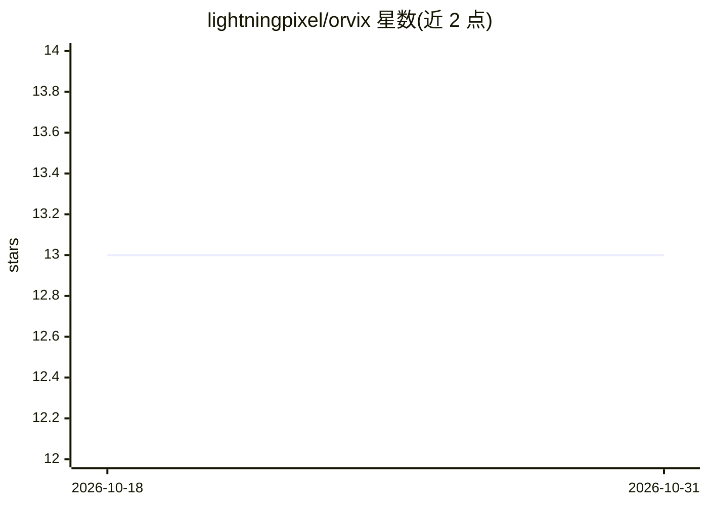

# lightningpixel/orvix

⭐ 13 · TypeScript · MIT · 推送 2026-10-27 · [GitHub](https://github.com/lightningpixel/orvix) · 个人维护

**给 AI 编程代理的省 token 代码地图 CLI：按符号查询代替全文阅读**

面向 AI coding agent 的命令行工具：用 tree-sitter 一次性索引代码库，为每个符号生成稳定短 ID，支持按 ID/名称精确读取单个函数源码、查询调用者/被调用者、影响面分析与符号级 diff；提供 orvix map 生成按任务聚焦、受 token 预算约束的符号地图。为 Claude Code 安装六个自动化 hook（读取压缩、焦点地图、影响提示等），并通过 MCP 协议服务其他 agent。调用图解析是语法级的，不含类型推断，Java/C# 等语言解析率约 27-36%。需 Node 20+，纯 JavaScript/WebAssembly，无需编译。

## 筛选速览

| 维度 | 判定 | 备注 |
|---|---|---|
| AI 角色 | `ai-ecosystem` | LLM/agent 周边工具 |
| 许可风险 | `permissive` | MIT |
| 部署形态 | `library` | 以包/库形式分发 |
| 模型依赖 | — | README 未给出锁定关系 |
| 硬件要求 | — | 无带数字的原话,不猜 |
| 安装摩擦 | `low` | 无编译、无系统依赖或容器化 |
| 成熟度 | — | 结构信号不足 |

## 能力要点

- tree-sitter 索引 + 稳定符号 ID，按符号精确读取源码
- orvix map 支持 --focus 任务聚焦与 --budget token 预算
- 为 Claude Code 安装 6 个 hook，其他 agent 经 MCP 接入
- 支持 TS/JS/Python/Go/Rust/Java/C#/C++/C 十种语言索引

## 适用场景

- 让 coding agent 用符号查询替代 grep 和读整个文件，节省上下文 token
- 改动前用 impact 命令查看调用方影响面与需跑的测试
- 为 Claude Code 配置自动读取压缩与焦点地图 hook

## 场景标签

 · 领域:开发者工具/AI 编程辅助

## 证据(README 行号)

> L10: Coding agents spend most of their context rediscovering structure: `ls`, then `grep`, then
> L132: `orvix mcp [path]` serves the index over the Model Context Protocol on stdio, for agents without

## 星数曲线

2026-10-18 13 → 2026-10-31 13（+0）

---
*卡片 v1 · prompt 1.4 · 生成 2026-10-31 · 置信度 high · 依据 README sha `b8df57bedc27` · [字段定义](../../DATASET.md)*
