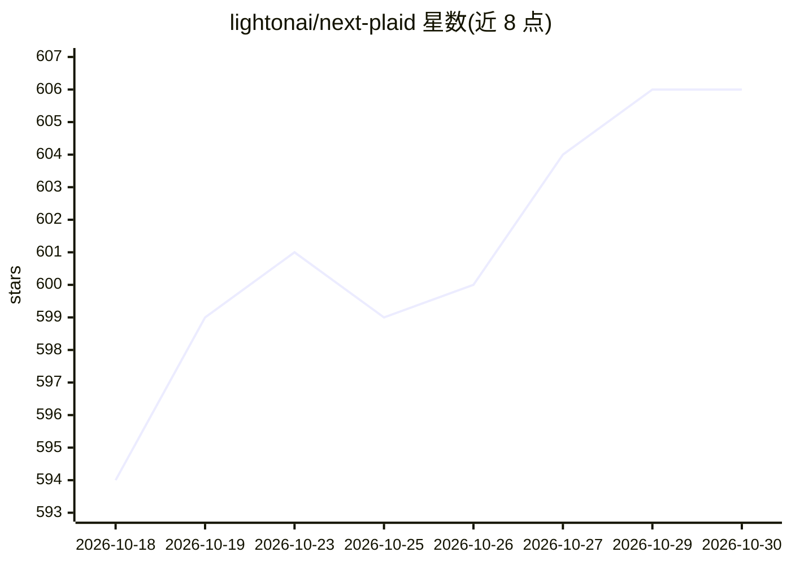

# lightonai/next-plaid

⭐ 606 · Rust · Apache-2.0 · 推送 2026-10-10 · [GitHub](https://github.com/lightonai/next-plaid) · [官网](https://lightonai.github.io/next-plaid/) · 组织维护

**本地多向量搜索引擎 NextPlaid 及其上的语义代码搜索工具 ColGREP**

包含两个部分：NextPlaid 是本地优先的多向量数据库，内置 ONNX Runtime 编码 ColBERT 模型，提供 REST API、内存映射索引、2/4-bit 乘积量化、增量更新与 SQLite 元数据预过滤，支持 CPU 与 CUDA，可用 Docker 部署；ColGREP 是构建于其上的终端语义代码搜索工具，组合正则过滤与语义排序，单个 Rust 二进制，附带 2B 本地搜索模型的 agent 模式，并提供 Claude Code/OpenCode/Codex/Hermes 集成安装命令。面向开发者和编码 agent 用户，代码与索引均留在本机。

## 筛选速览

| 维度 | 判定 | 备注 |
|---|---|---|
| AI 角色 | `ai-ecosystem` | LLM/agent 周边工具 |
| 许可风险 | `permissive` | Apache-2.0 |
| 部署形态 | `self-host` | docker 或自建部署 |
| 模型依赖 | — | README 未给出锁定关系 |
| 硬件要求 | — | 无带数字的原话,不猜 |
| 安装摩擦 | `low` | 无编译、无系统依赖或容器化 |
| 成熟度 | — | 结构信号不足 |

## 能力要点

- ColGREP 单个 Rust 二进制，正则与语义结合的本地代码搜索
- NextPlaid 多向量数据库：REST API、内置编码、量化、增量更新、元数据预过滤
- agent 模式由本地 2B 模型反复调用 colgrep 并返回回答所在行
- 4 个编码 agent 工具集成（Claude Code/OpenCode/Codex/Hermes）

## 适用场景

- 在终端或编码 agent 中对代码库做语义搜索
- 作为通用多向量检索引擎用 REST API 服务文档检索负载
- 让编码 agent 通过工具调用减少上下文消耗地定位代码

## 场景标签

`向量数据库` `语义搜索` · 领域:知识与检索

## 证据(README 行号)

> L2:  NextPlaid is a multi-vector search engine. ColGREP is semantic code search, built on it.
> L128: A local-first multi-vector database with a REST API. It's what powers ColGREP under the hood, but it's a general-p
> L92: **Agent mode.** Your coding agent (Claude, GPT, Gemini, …) can call `colgrep` itself, or hand the whole question to

## 星数曲线

2026-10-18 594 → 2026-10-30 606（+12）

---
*卡片 v1 · prompt 1.4 · 生成 2026-10-21 · 置信度 high · 依据 README sha `797a14aa3da1` · [字段定义](../../DATASET.md)*
