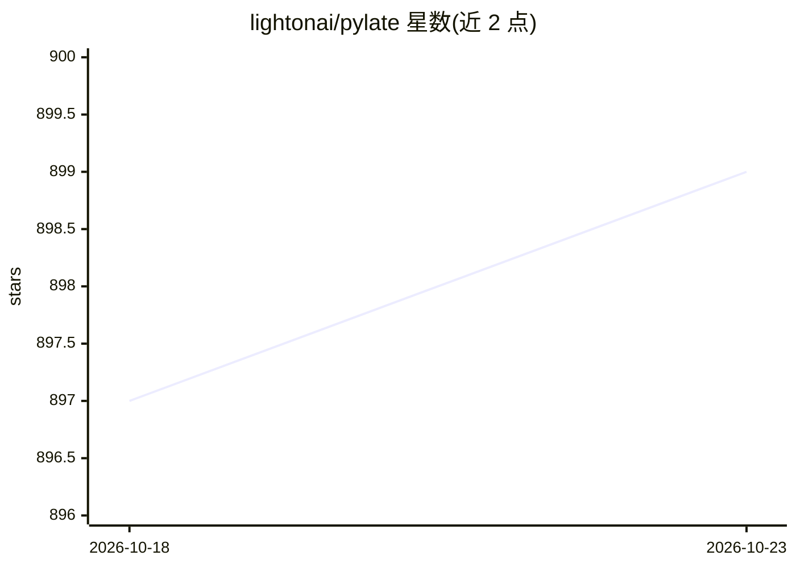

# lightonai/pylate

⭐ 899 · Python · MIT · 推送 2026-07-23 · [GitHub](https://github.com/lightonai/pylate) · [官网](https://lightonai.github.io/pylate/) · 组织维护

**ColBERT 迟交互模型的微调、推理与检索库**

基于 Sentence Transformers 构建的 Python 库，面向使用迟交互（ColBERT）模型的研究者与开发者：支持单卡与多卡（含 GradCache 模拟大 batch、跨设备 gather）的对比训练与知识蒸馏微调，可从多数预训练语言模型构建 ColBERT 模型；检索方面提供 FastPLAID 索引、可选 WARP 与 TACHIOM 后端（TACHIOM 在 CPU 上运行多向量检索），以及无需建索引的 rerank 函数。支持 Hugging Face Datasets 格式的三元组与蒸馏数据集，附 NanoBEIR 快速评测器。通过 pip 安装。

## 筛选速览

| 维度 | 判定 | 备注 |
|---|---|---|
| AI 角色 | `ai-ecosystem` | LLM/agent 周边工具 |
| 许可风险 | `permissive` | MIT |
| 部署形态 | `library` | 以包/库形式分发 |
| 模型依赖 | — | README 未给出锁定关系 |
| 硬件要求 | — | 无带数字的原话,不猜 |
| 安装摩擦 | `low` | 无编译、无系统依赖或容器化 |
| 成熟度 | — | 结构信号不足 |

## 能力要点

- 单卡/多卡 ColBERT 对比训练与知识蒸馏（含 CachedContrastive/GradCache）
- FastPLAID 索引检索，可选 WARP 与 CPU 多向量检索后端 TACHIOM
- rank.rerank 支持免建索引的重排
- 支持 Hugging Face Datasets 多负例三元组与蒸馏数据集，NanoBEIR 快速评测

## 适用场景

- 在自己的数据上微调 ColBERT 检索模型
- 构建并查询多向量文档索引，做 top-k 检索
- 在第一阶段检索结果上做 ColBERT 重排

## 场景标签

`微调` `语义搜索` `模型评测` · 领域:评测与运维

## 证据(README 行号)

> L10: PyLate is a library built on top of Sentence Transformers, designed to simplify and optimize fine-tuning, inference
> L134: PyLate provides an efficient index with FastPLAID. Simply load a ColBERT model and initialize the index to perform

## 星数曲线

2026-10-18 897 → 2026-10-23 899（+2）

---
*卡片 v1 · prompt 1.4 · 生成 2026-10-21 · 置信度 high · 依据 README sha `8a309597f2ab` · [字段定义](../../DATASET.md)*
