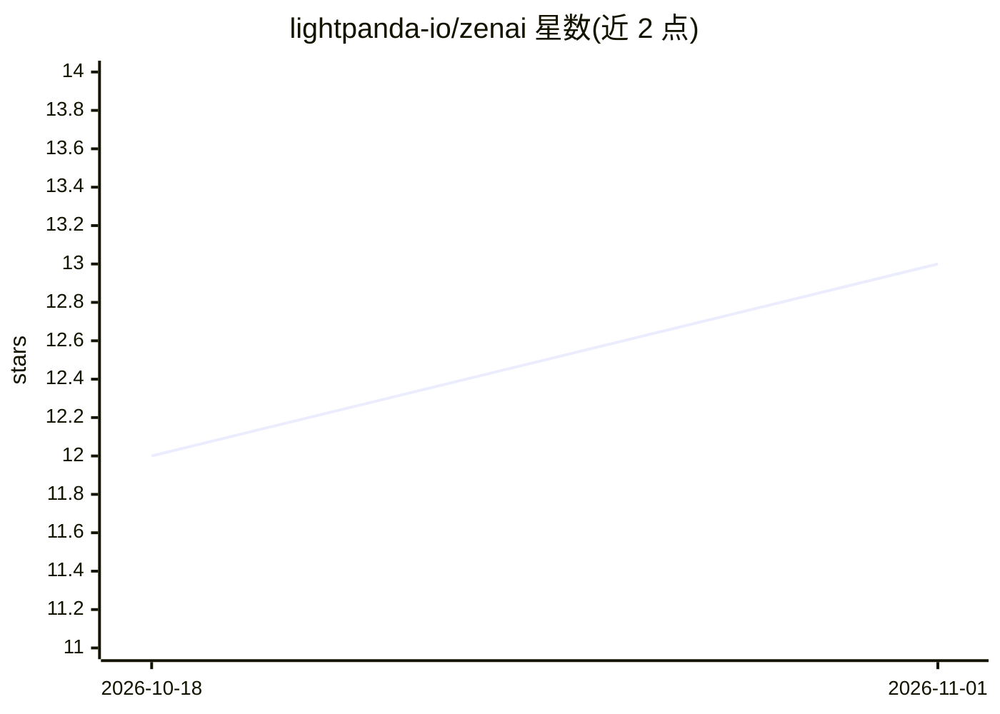

# lightpanda-io/zenai

⭐ 13 · Zig · Apache-2.0 · 推送 2026-10-31 · [GitHub](https://github.com/lightpanda-io/zenai) · 组织维护

**Zig 编写的多 AI API 客户端库：统一接口访问 LLM/搜索/判断模型**

从官方 Go SDK 移植的 Zig 客户端库，供 Zig 开发者接入 AI 服务。LLM 部分覆盖 Google Gemini（Developer API 与 Vertex AI 两种模式）、OpenAI 及任意 OpenAI 兼容端点（本地 Ollama、llama.cpp、LLMD，托管 Mistral、xAI，网关 OpenRouter、Vercel 等）、Anthropic、以及走 ChatGPT 订阅计费的 Codex 后端；另有统一接口的搜索客户端（Tavily、Brave、Exa、Keenable、Parallel）与 TypeSafe System One 判断模型客户端（概率/选项/评分的类型化问答，单请求上限 64k tokens）。通过 provider.Client 抽象切换后端，也支持绕过抽象使用各后端专有特性。要求 Zig >= 0.17.0，以 zig fetch 方式安装。

## 筛选速览

| 维度 | 判定 | 备注 |
|---|---|---|
| AI 角色 | `ai-ecosystem` | LLM/agent 周边工具 |
| 许可风险 | `permissive` | Apache-2.0 |
| 部署形态 | `None` |  |
| 模型依赖 | local-ok | 支持本地模型 |
| 硬件要求 | — | 无带数字的原话,不猜 |
| 安装摩擦 | `low` | 无编译、无系统依赖或容器化 |
| 成熟度 | — | 结构信号不足 |

## 能力要点

- provider.Client 将所有 LLM 后端包装为统一接口，切换后端仅需改一行构造
- Codex 通道以 ChatGPT 订阅 OAuth token 计费，区别于 API credits
- 五个搜索 API 客户端遵循同一 init/search 形状
- TypeSafe Jev 判断模型：单次请求并行评估多个类型化问题

## 适用场景

- 在 Zig 项目中调用 Gemini/OpenAI/Anthropic 等模型生成内容
- 让同一套代码在本地 Ollama/llama.cpp 与云端模型间切换
- 以 ChatGPT 订阅而非 API credits 使用 OpenAI 模型
- 在应用中接入 Tavily/Brave 等搜索 API

## 场景标签

`模型网关` · 领域:Agent 开发

## 证据(README 行号)

> L3: Zig client for AI APIs, ported from the official Go SDKs (go-genai, openai-go, anthropic-sdk-go). It covers:
> L47: `zenai.provider.Client` wraps every LLM backend behind one interface, so switching providers means changing the lin
> L78: Gateway model ids are provider-prefixed (`"anthropic/claude-sonnet-5"`). For Hugging Face, pass `.base_url` to targ

## 星数曲线

2026-10-18 12 → 2026-11-01 13（+1）

---
*卡片 v1 · prompt 1.4 · 生成 2026-10-31 · 置信度 high · 依据 README sha `0c0e90513352` · [字段定义](../../DATASET.md)*
