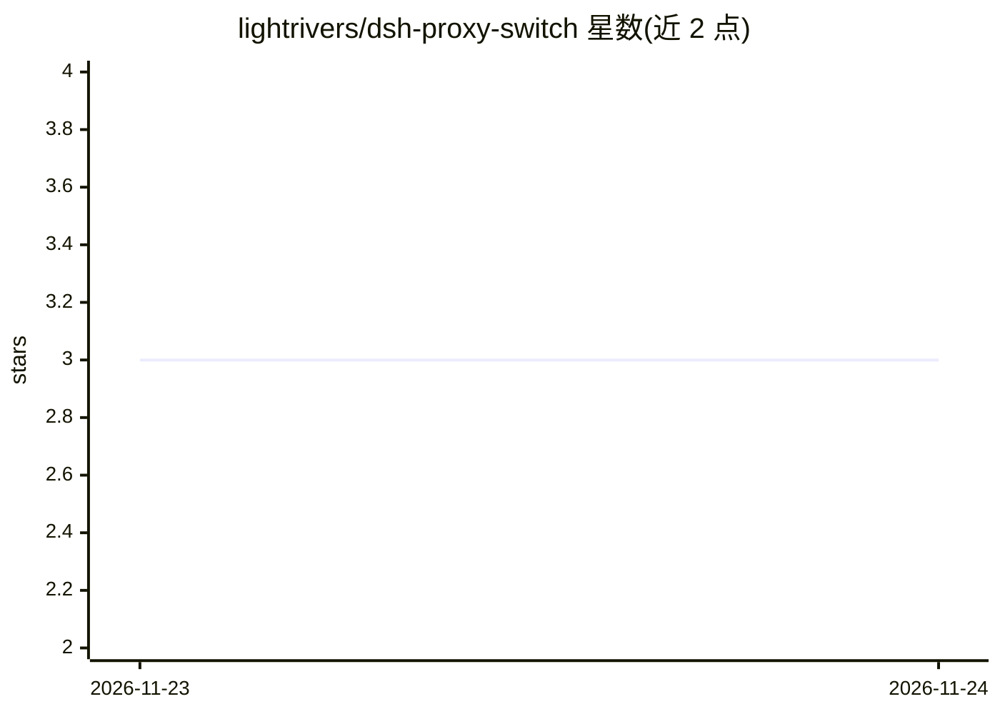

# lightrivers/dsh-proxy-switch

⭐ 3 · JavaScript · MIT · 推送 2026-11-05 · [GitHub](https://github.com/lightrivers/dsh-proxy-switch) · [官网](https://www.npmjs.com/package/@lightrivers/dsh-proxy-switch) · 个人维护 · 中文 README

**让 DeepSeek Harness 的 web_fetch 在代理软件下正常抓网页的插件**

DeepSeek Harness（DSH）的插件，解决 Clash/Surge/v2rayN 等代理软件的 TUN/fake-IP 模式导致 web_fetch 报 non-public IP 错误的问题。插件自动检测本机 HTTP 代理（读系统代理设置、环境变量、扫描常见端口并逐一握手验证），代理运行时让 web_fetch 走代理、关闭后自动直连，默认只影响 web_fetch。要求 DSH 桌面版 0.2.1/0.2.2，仅支持 HTTP 代理（不支持 SOCKS/PAC），macOS 完整验证，Windows/Linux 代码支持但未完整验证。

## 筛选速览

| 维度 | 判定 | 备注 |
|---|---|---|
| AI 角色 | `ai-enhanced` | 去掉 AI 部分产品仍成立 |
| 许可风险 | `permissive` | MIT |
| 部署形态 | `library` | 以包/库形式分发 |
| 模型依赖 | locked-api |  |
| 硬件要求 | — | 无带数字的原话,不猜 |
| 安装摩擦 | `low` | 无编译、无系统依赖或容器化 |
| 成熟度 | — | 结构信号不足 |

## 能力要点

- 自动检测本机 HTTP 代理并按代理开关自动切换线路
- fake-IP（198.18.x.x）场景下规避 web_fetch 的内网安全检查拒绝
- 作用范围默认仅 web_fetch，不影响模型对话与其它工具
- 私有通道每次启动生成随机令牌，仅监听 127.0.0.1

## 适用场景

- 开着 Clash TUN 模式时让 DSH 的 web_fetch 能抓网页
- 只开系统代理、DSH 不读系统代理的环境
- 需要代理开关时自动切换、关代理后不断连

## 场景标签

`网页抓取` · 领域:效率与自动化

## 证据(README 行号)

> L1: # 代理开关 · dsh-proxy-switch
> L11: **开着 Clash、Surge、v2rayN 这类代理软件时，DeepSeek Harness 的 `web_fetch` 抓不了网页？装上这个插件就好了。**
> L39: |DeepSeek Harness|桌面版 0.2.1、0.2.2（0.2.2-rc.1 已测）|

## 星数曲线

2026-11-23 3 → 2026-11-24 3（+0）

---
*卡片 v1 · prompt 1.4 · 生成 2026-11-23 · 置信度 mid · 依据 README sha `8e18a9a79f69` · [字段定义](../../DATASET.md)*
