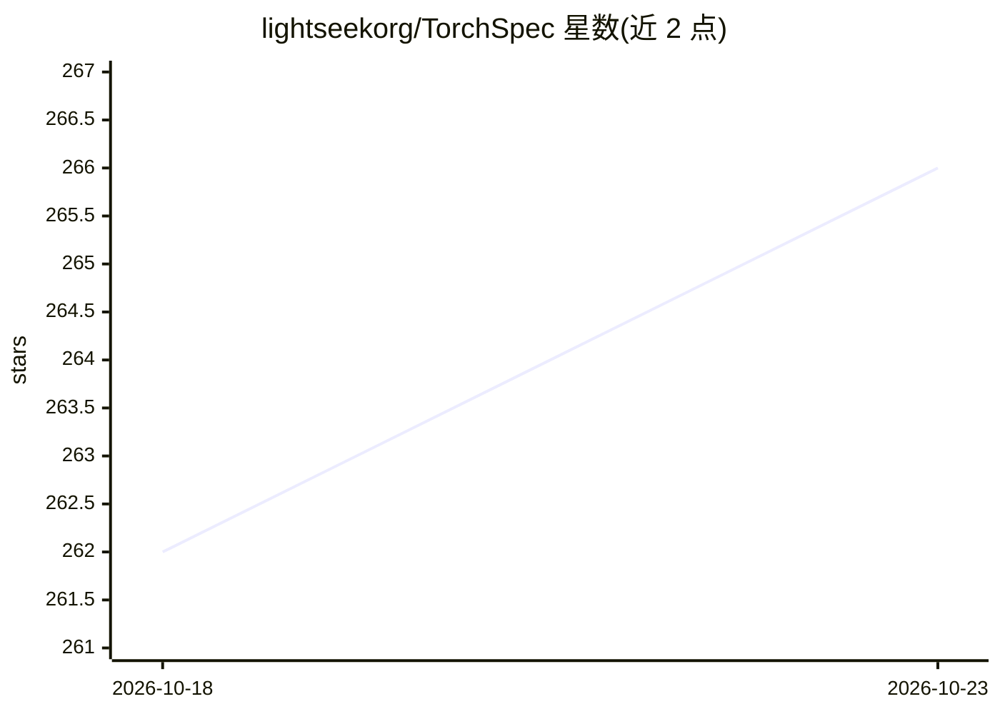

# lightseekorg/TorchSpec

⭐ 266 · Python · MIT · 推送 2026-10-19 · [GitHub](https://github.com/lightseekorg/TorchSpec) · [官网](https://pytorch.org/blog/torchspec-speculative-decoding-training-at-scale/) · 组织维护

**PyTorch 原生的投机解码草稿模型训练框架**

面向 LLM 推理加速场景的 torch 原生训练框架：采用推理与训练分离的架构，推理引擎（vLLM/TensorRT-LLM/SGLang/HF Transformers 等）产出目标模型隐状态，经 Mooncake store 直接流式传输给分布式训练 worker（FSDP），用于训练 EAGLE3、DFlash、DSpark 等投机解码草稿模型。支持离线回放训练、断点恢复/续训、HF checkpoint 转换与词表剪枝。限制：TensorRT-LLM 后端目前仅支持单节点张量并行；TokenSpeed 后端需 Python 3.12。已被 vLLM 生态与多家生产推理平台采用。

## 筛选速览

| 维度 | 判定 | 备注 |
|---|---|---|
| AI 角色 | `ai-ecosystem` | LLM/agent 周边工具 |
| 许可风险 | `permissive` | MIT |
| 部署形态 | `self-host` | docker 或自建部署 |
| 模型依赖 | local-ok | 支持本地模型 |
| 硬件要求 | — | 无带数字的原话,不猜 |
| 安装摩擦 | `low` | 无编译、无系统依赖或容器化 |
| 成熟度 | — | 结构信号不足 |

## 能力要点

- 推理与训练解耦，隐状态经 Mooncake store 流式传输免落盘
- 支持 vLLM/TensorRT-LLM（一级）、SGLang/HF Transformers（社区）多种推理后端
- 支持 EAGLE3/DFlash/DSpark 草稿模型训练、FSDP 转 HF、词表剪枝
- 提供断点恢复、续训与 HF checkpoint 热启动转换工具

## 适用场景

- 为线上大模型训练投机解码草稿模型以加速推理
- 在多节点 GPU 集群上分离扩展推理与训练两侧
- 从 Hugging Face checkpoint 转换并热启动草稿模型训练

## 场景标签

`微调` · 领域:训练与推理

## 证据(README 行号)

> L3: TorchSpec is a torch-native speculative decoding training framework. We introduce a disaggregated way of training sp
> L49: - **Inference engines** generate target-model hidden states with inference engines.
> L61: |vLLM|First-class|Available|

## 星数曲线

2026-10-18 262 → 2026-10-23 266（+4）

---
*卡片 v1 · prompt 1.4 · 生成 2026-10-22 · 置信度 mid · 依据 README sha `4f88b907fd0a` · [字段定义](../../DATASET.md)*
