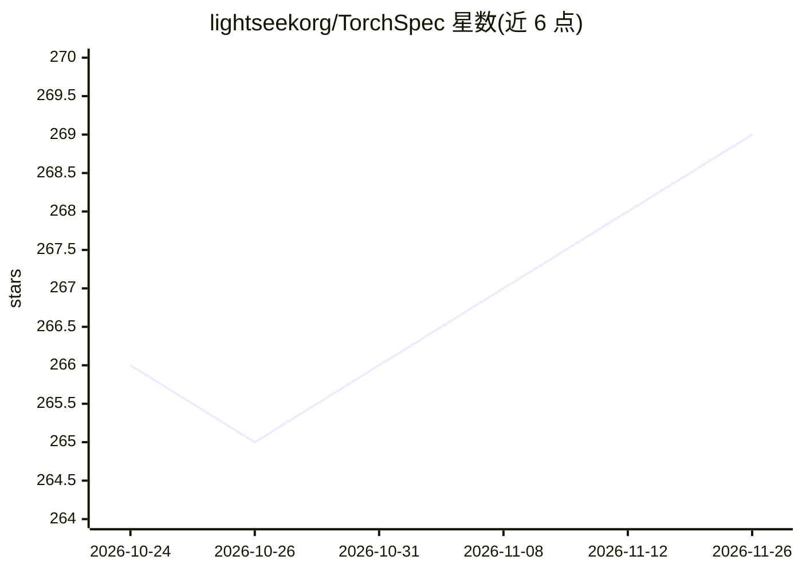

# lightseekorg/TorchSpec

⭐ 269 · Python · MIT · 推送 2026-11-21 · [GitHub](https://github.com/lightseekorg/TorchSpec) · [官网](https://pytorch.org/blog/torchspec-speculative-decoding-training-at-scale/) · 组织维护

**面向 LLM 团队的推测解码草稿模型分布式训练框架**

TorchSpec 是一个 torch 原生的推测解码草稿模型训练框架，采用推理与训练完全解耦的分离式架构：推理引擎组生成目标模型隐藏状态，经 Mooncake store 直接流式传输给分布式训练 worker，两侧可独立扩展。支持 EAGLE3、DFlash、DSpark 等草稿模型训练，提供多后端推理支持、离线回放训练、断点恢复、检查点格式转换与词表剪枝。安装需 Rust 工具链（源码构建）或使用预构建 wheel/Docker 镜像。被 vLLM、DigitalOcean、CoreWeave 等生产平台采用。

## 筛选速览

| 维度 | 判定 | 备注 |
|---|---|---|
| AI 角色 | `ai-ecosystem` | LLM/agent 周边工具 |
| 许可风险 | `permissive` | MIT |
| 部署形态 | `self-host` | docker 或自建部署 |
| 模型依赖 | local-ok | 支持本地模型 |
| 硬件要求 | — | 无带数字的原话,不猜 |
| 安装摩擦 | `low` | 无编译、无系统依赖或容器化 |
| 成熟度 | — | 结构信号不足 |

## 能力要点

- 推理与训练解耦：隐藏状态经 Mooncake store 流式传输，两侧独立扩展
- 多推理后端：vLLM/TensorRT-LLM 一等支持，SGLang/Transformers 社区支持
- EAGLE3/DFlash/DSpark 多种草稿模型训练模式与词表剪枝
- FSDP 检查点转 HuggingFace 格式及 HF checkpoint 热启动工具

## 适用场景

- 为大模型训练 EAGLE3 推测解码草稿模型以提升推理吞吐
- 在单节点 4 卡环境快速试验草稿模型训练流程
- 将 FSDP 训练检查点转换为 HuggingFace 格式部署
- 从已有 DFlash 模型热启动 DSpark 训练

## 场景标签

`模型训练` · 领域:训练与推理

## 证据(README 行号)

> L3: TorchSpec is a torch-native speculative decoding training framework. We introduce a disaggregated way of training sp
> L48: TorchSpec is built around a disaggregated training pipeline:
> L62: |vLLM|First-class|Available|

## 星数曲线

2026-10-24 266 → 2026-11-26 269（+3）

---
*卡片 v1 · prompt 1.4 · 生成 2026-11-25 · 置信度 high · 依据 README sha `1b6823020dbe` · [字段定义](../../DATASET.md)*
