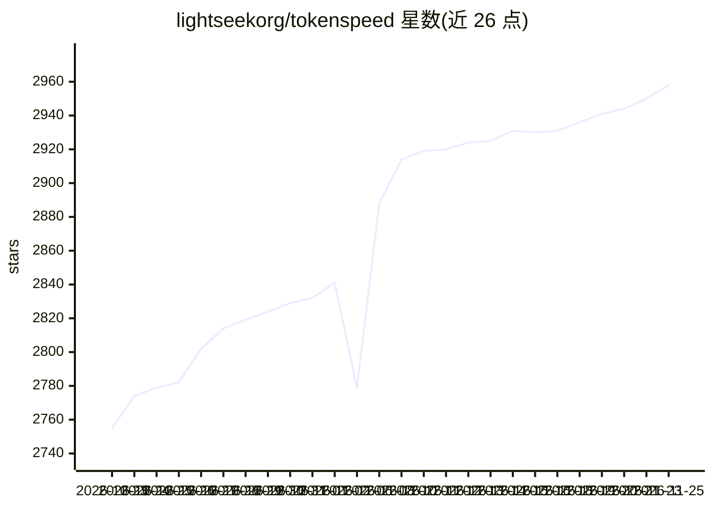

# lightseekorg/tokenspeed

⭐ 2,958 · Python · MIT · 推送 2026-11-24 · [GitHub](https://github.com/lightseekorg/tokenspeed) · [官网](https://lightseek.org/blog/lightseek-tokenspeed.html) · 组织维护

**面向 agentic 工作负载的开源 LLM 推理引擎**

由 LightSeek 非营利基金会维护的 LLM 推理引擎，面向生产环境 agentic 工作负载。核心包括：C++ 控制平面与 Python 执行平面分离的调度器，请求生命周期与 KV 缓存状态以有限状态机编码并在编译期由类型系统强制安全复用；可插拔的分层内核系统，含 Blackwell 上的 MLA 实现；由 Rust 驱动的入口点，请求路径无 Python。已加入 PyTorch Ecosystem Landscape，获 NVIDIA 与 AMD 硬件与工程支持。README 未给出安装命令，仅提供文档链接索引。

## 筛选速览

| 维度 | 判定 | 备注 |
|---|---|---|
| AI 角色 | `ai-ecosystem` | LLM/agent 周边工具 |
| 许可风险 | `permissive` | MIT |
| 部署形态 | `None` |  |
| 模型依赖 | — | README 未给出锁定关系 |
| 硬件要求 | — | 无带数字的原话,不猜 |
| 安装摩擦 | `low` | 无编译、无系统依赖或容器化 |
| 成熟度 | `idea` | |

## 能力要点

- 控制平面（C++ 有限状态机）与执行平面（Python）分离的调度架构
- 内核作为一等模块化子系统：可移植公共 API、集中注册表与插件机制
- 请求路径无 Python，由 SMG 和 Dynamo 经 msgpack 驱动
- 已加入 PyTorch Ecosystem Landscape

## 适用场景

- 为生产环境 agentic 应用提供 LLM 推理服务
- 在 NVIDIA/AMD 加速器上部署大模型服务
- 查找前沿模型的推理优化方案（模型配方文档）

## 场景标签

`推理引擎` · 领域:训练与推理

## 证据(README 行号)

> L5: TokenSpeed is a speed-of-light LLM inference engine designed for **agentic workloads**, with TensorRT-LLM-level perf
> L22: > TokenSpeed is an open source LLM inference engine and the first to separate the control plane from the execution 
> L26: More importantly, TokenSpeed is the **Switzerland** of open-source LLM inference engines: neutral because it's back

## 星数曲线

2026-10-23 2,755 → 2026-11-25 2,958（+203）

---
*卡片 v1 · prompt 1.4 · 生成 2026-11-23 · 置信度 high · 依据 README sha `5e814d585f0d` · [字段定义](../../DATASET.md)*
