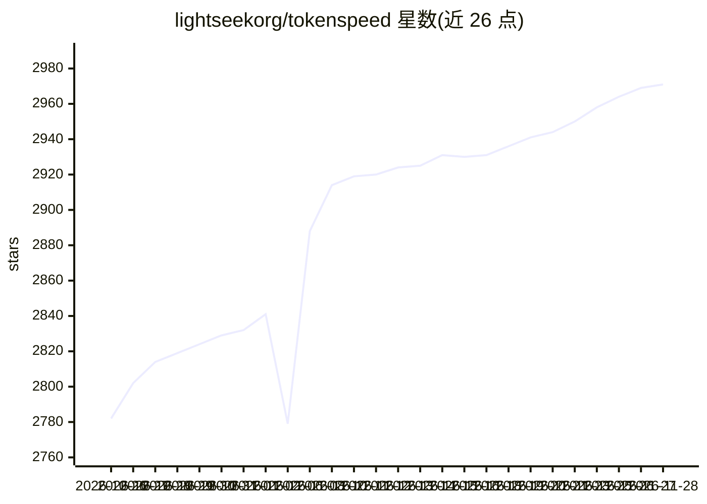

# lightseekorg/tokenspeed

⭐ 2,971 · Python · MIT · 推送 2026-11-27 · [GitHub](https://github.com/lightseekorg/tokenspeed) · [官网](https://lightseek.org/blog/lightseek-tokenspeed.html) · 组织维护

**面向 agentic 工作负载的 LLM 推理引擎**

由非营利 LightSeek Foundation 维护的 LLM 推理引擎，定位服务于生产环境的 agentic 工作负载。核心机制：控制平面用 C++ 有限状态机实现，以类型系统在编译期管理请求生命周期与 KV cache 资源；执行平面用 Python 实现；内核以可插拔模块与集中注册表提供，包含面向 Blackwell 的 MLA 实现；请求路径经 Rust 入口以 msgpack 驱动、无 Python 参与。README 未给出安装命令，文档入口指向外部 Getting Started 等页面。

## 筛选速览

| 维度 | 判定 | 备注 |
|---|---|---|
| AI 角色 | `ai-ecosystem` | LLM/agent 周边工具 |
| 许可风险 | `permissive` | MIT |
| 部署形态 | `None` |  |
| 模型依赖 | — | README 未给出锁定关系 |
| 硬件要求 | — | 无带数字的原话,不猜 |
| 安装摩擦 | `low` | 无编译、无系统依赖或容器化 |
| 成熟度 | — | 结构信号不足 |

## 能力要点

- 控制平面（C++ 状态机）与执行平面（Python）分离的架构
- 可插拔内核系统，含 Blackwell 上 MLA 实现
- 请求路径经 Rust + msgpack，无 Python 参与
- 加入 PyTorch Ecosystem Landscape

## 适用场景

- 为生产环境的 agentic 应用提供模型服务
- 在 NVIDIA/AMD GPU 上部署大模型推理服务
- 查阅 Day 0 支持新模型（Kimi/GLM/Qwen 等）的部署方案

## 场景标签

`推理引擎` · 领域:训练与推理

## 证据(README 行号)

> L5: TokenSpeed is a speed-of-light LLM inference engine designed for **agentic workloads**, with TensorRT-LLM-level perf
> L7: Core components:
> L20: TokenSpeed takes a fundamentally different architectural approach from existing LLM inference engines. The **PyTorc

## 星数曲线

2026-10-26 2,782 → 2026-11-28 2,971（+189）

---
*卡片 v1 · prompt 1.4 · 生成 2026-11-27 · 置信度 high · 依据 README sha `1392e990eae5` · [字段定义](../../DATASET.md)*
