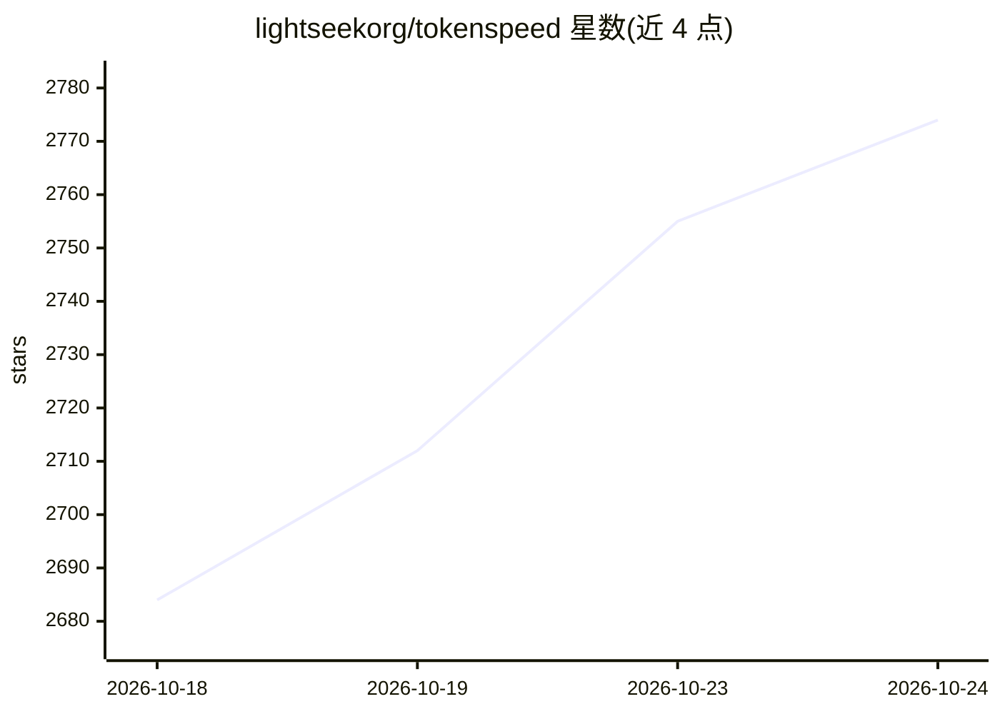

# lightseekorg/tokenspeed

⭐ 2,779 · Python · MIT · 推送 2026-10-24 · [GitHub](https://github.com/lightseekorg/tokenspeed) · [官网](https://lightseek.org/blog/lightseek-tokenspeed.html) · 组织维护

**面向 agentic 负载的 LLM 推理引擎，C++ 控制面+Python 执行面**

由非营利 LightSeek Foundation 维护的开源 LLM 推理引擎，面向生产级 agentic 工作负载。架构上将控制面（C++ 有限状态机，编译期类型系统保证 KV cache 与请求生命周期安全）与执行面（Python）分离；内核为可插拔分层子系统，含面向 Blackwell 的 MLA 实现；入口为 SMG 集成的 AsyncLLM。README 提及 NVIDIA 与 AMD 提供硬件与工程支持，并列出多款模型在 GB200/GB300/MI355X 上的服务案例。安装命令未在 README 可见部分给出，仅链接到外部文档（Getting Started / Launching a Server 等）。

## 筛选速览

| 维度 | 判定 | 备注 |
|---|---|---|
| AI 角色 | `ai-ecosystem` | LLM/agent 周边工具 |
| 许可风险 | `permissive` | MIT |
| 部署形态 | `None` |  |
| 模型依赖 | — | README 未给出锁定关系 |
| 硬件要求 | — | 无带数字的原话,不猜 |
| 安装摩擦 | `low` | 无编译、无系统依赖或容器化 |
| 成熟度 | — | 结构信号不足 |

## 能力要点

- C++ 控制面+Python 执行面分离，编译期类型系统保证 KV 资源安全复用
- 可插拔分层内核系统，含 Blackwell 上的 MLA 实现
- SMG 集成的 AsyncLLM 入口做低开销 CPU 侧请求处理
- News 列出多款模型（Kimi/Qwen/GLM/DeepSeek 生态相关）在 GB200/GB300/MI355X 上的服务记录

## 适用场景

- 部署生产级 agentic 工作负载的 LLM 推理服务
- 需要 MLA 内核与 Blackwell/AMD 加速器支持的高吞吐推理
- 研究团队在 Python 执行面上快速迭代推理实验

## 场景标签

`推理引擎` · 领域:训练与推理

## 证据(README 行号)

> L3: TokenSpeed is a speed-of-light LLM inference engine designed for **agentic workloads**, with TensorRT-LLM-level perf
> L7: - **Scheduler**: C++ control plane and Python execution plane. Request
> L20: > TokenSpeed is an open source LLM inference engine and the first to separate the control plane from the execution 

## 星数曲线

2026-10-18 2,684 → 2026-10-24 2,774（+90）

---
*卡片 v1 · prompt 1.4 · 生成 2026-10-21 · 置信度 high · 依据 README sha `b5d4d45235c3` · [字段定义](../../DATASET.md)*
