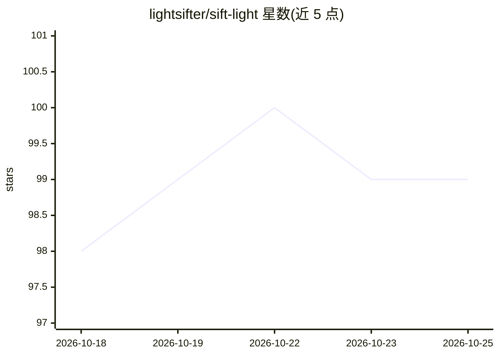

# lightsifter/sift-light

⭐ 99 · JavaScript · AGPL-3.0 · 推送 2026-10-14 · [GitHub](https://github.com/lightsifter/sift-light) · 个人维护 · 中文 README

**面向 AI agent 的本地证据优先文本搜索插件（MCP/Pi/OMP）**

通用本地搜索插件，帮助 agent 在文件、文档、笔记、日志等文本中定位内容：少量命中直接返回文本与位置，命中多时先给出文件与片段概览再分页查看；支持多条件组合、文件夹限定、分页续读与源变更校验。默认走快速精确路径，可选启用本地嵌入模型（npx 安装、E5 worker，缓存 512 MiB）做 concept/hybrid 语义检索，并明确语言导航类请求会直接拒绝而非降级。通过 Pi、OMP 扩展与 MCP 服务器接入，另提供 audit/validate/capabilities 等模式。

## 筛选速览

| 维度 | 判定 | 备注 |
|---|---|---|
| AI 角色 | `ai-ecosystem` | LLM/agent 周边工具 |
| 许可风险 | `viral` | AGPL-3.0 |
| 部署形态 | `library` | 以包/库形式分发 |
| 模型依赖 | — | README 未给出锁定关系 |
| 硬件要求 | — | 无带数字的原话,不猜 |
| 安装摩擦 | `low` | 无编译、无系统依赖或容器化 |
| 成熟度 | — | 结构信号不足 |

## 能力要点

- 精确/概念/混合三种检索模式，语义检索默认关闭需显式开启
- 分页快照与 inspectRequest 续读，源变更可用 validate 模式校验（current/stale/unknown）
- JavaScript/TypeScript/TSX/Go/Python 的 AST 结构与角色分析能力清单
- audit 模式输出带覆盖声明的有界核查回执

## 适用场景

- 让编程 agent 用一句话定位代码库中的报错或段落
- 在大量文档中先看命中地图再决定打开哪个文件
- 校验 agent 已引用的源码证据是否仍与工作区一致

## 场景标签

`语义搜索` · 领域:知识与检索

## 证据(README 行号)

> L5: **sift-light — Evidence-first search for AI agents.**
> L7: **A general-purpose local search plugin that helps agents find files, documents, notes, logs and other text material
> L27: For routine development work, searches with a known name, symbol, filename or error text use the fast exact path by

## 星数曲线

2026-10-18 98 → 2026-10-25 99（+1）

---
*卡片 v1 · prompt 1.4 · 生成 2026-10-23 · 置信度 high · 依据 README sha `ad659862689c` · [字段定义](../../DATASET.md)*
