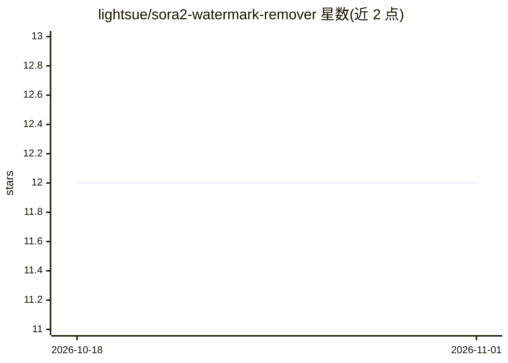

# lightsue/sora2-watermark-remover

⭐ 12 · Python · GPL-3.0 · 推送 2025-12-04 · [GitHub](https://github.com/lightsue/sora2-watermark-remover) · 个人维护

**去除 Sora 2 生成视频水印的 AI 工具**

上传 Sora 2 生成的视频后，系统逐帧检测水印位置并通过 inpainting 修复，随后渲染并返回处理后的视频，结果保存在 output 文件夹。提供两种运行方式：运行 main.py 在浏览器中打开本地上传页面，或运行 server.py 启动 8000 端口的 web 服务用于集成到其他项目。要求 Python 3.10+、4GB 以上内存与 ffmpeg，支持 Windows/macOS/Linux，通过 git clone 源码安装。

## 筛选速览

| 维度 | 判定 | 备注 |
|---|---|---|
| AI 角色 | `ai-native` | 本体是模型或模型工具 |
| 许可风险 | `viral` | GPL-3.0 |
| 部署形态 | `library` | 以包/库形式分发 |
| 模型依赖 | — | README 未给出锁定关系 |
| 硬件要求 | — | 无带数字的原话,不猜 |
| 安装摩擦 | `medium` | 含编译或系统依赖之一 |
| 成熟度 | — | 结构信号不足 |

## 能力要点

- 逐帧检测水印并以 inpainting 方式移除
- main.py 本地浏览器界面与 server.py web 服务两种使用方式
- 跨平台支持（Windows/macOS/Linux），最低 4GB 内存

## 适用场景

- 处理 Sora 2 生成的视频以去除其水印
- 通过 web 服务接口将去水印功能接入自己的项目

## 场景标签

`图像视频处理` · 领域:感知与多模态

## 证据(README 行号)

> L5: This project is designed to precisely remove watermarks from Sora 2 generated videos using AI.
> L8: This project uses AI to remove watermarks from Sora 2 generated videos. When a user uploads a video, the system anal

## 星数曲线

2026-10-18 12 → 2026-11-01 12（+0）

---
*卡片 v1 · prompt 1.4 · 生成 2026-11-01 · 置信度 mid · 依据 README sha `e591e613c574` · [字段定义](../../DATASET.md)*
