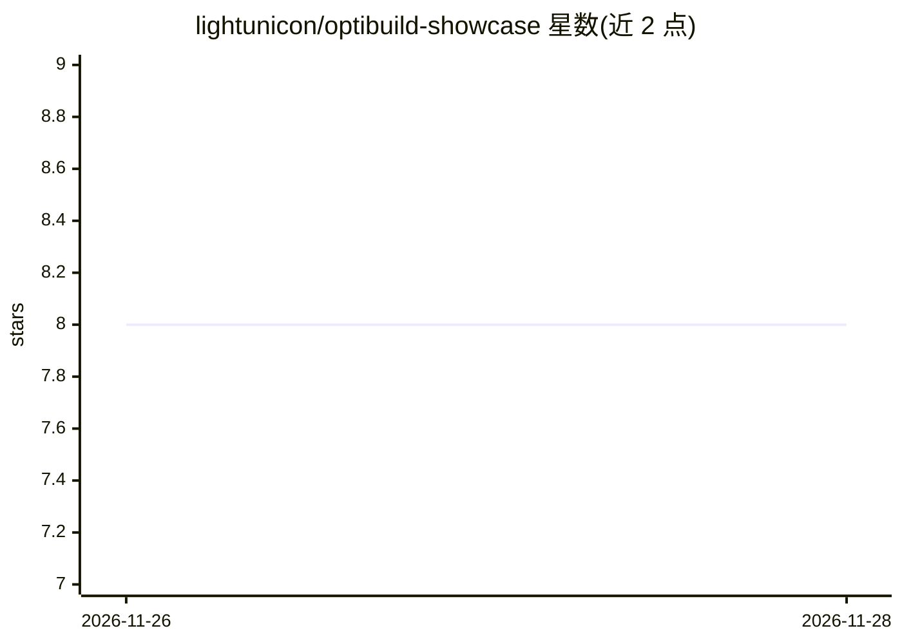

# lightunicon/optibuild-showcase

⭐ 8 · 推送 2026-11-11 · [GitHub](https://github.com/lightunicon/optibuild-showcase) · 个人维护

**AI 工地管理平台 OptiBuild 的工程案例研究文档**

一个案例展示仓库（源码私有）：记录 OptiBuild 建筑工地管理平台的架构与工程决策。平台将 500+ 页工程量清单 PDF 解析为结构化行项，同一份数据驱动报价、成本、进度报表、材料与仪表盘等七个模块；AI 部分包括文档解析、报价建议与应用内对话辅助，产出需人工复核。数据层为 170+ 张表、8 角色行级安全与审计轨迹，应用以 React SPA + Laravel API 交付并打包为 iOS/Android 移动端。

## 筛选速览

| 维度 | 判定 | 备注 |
|---|---|---|
| AI 角色 | `ai-enhanced` | 去掉 AI 部分产品仍成立 |
| 许可风险 | `none` | — |
| 部署形态 | `None` |  |
| 模型依赖 | — | README 未给出锁定关系 |
| 硬件要求 | — | 无带数字的原话,不猜 |
| 安装摩擦 | `low` | 无编译、无系统依赖或容器化 |
| 成熟度 | — | 结构信号不足 |

## 能力要点

- 工程量清单 PDF/DCF 解析为结构化行项（500+ 页文档流水线）
- 先分块后解释的文档 AI 流水线，Python 抽取与应用层语义解释分离
- 数据层行级权限（8 角色）与审计轨迹，170+ 张表
- 同一 Web 客户端打包为 iOS/Android 移动构建并带地理定位

## 适用场景

- 了解长文档解析流水线的架构拆分方式
- 参考多模块共享单一结构化数据源的设计决策
- 研究建筑行业数字化平台的角色权限设计

## 场景标签

`文档解析` · 领域:知识与检索

## 证据(README 行号)

> L1: # OptiBuild — intelligent construction-site management
> L86: - **Document parsing** of quantity surveys, from long PDFs and industry exchange formats into
> L134: The source code is maintained in a private repository: OptiBuild is a commercial product with

## 星数曲线

2026-11-26 8 → 2026-11-28 8（+0）

---
*卡片 v1 · prompt 1.4 · 生成 2026-11-26 · 置信度 high · 依据 README sha `0316c38d4a5a` · [字段定义](../../DATASET.md)*
