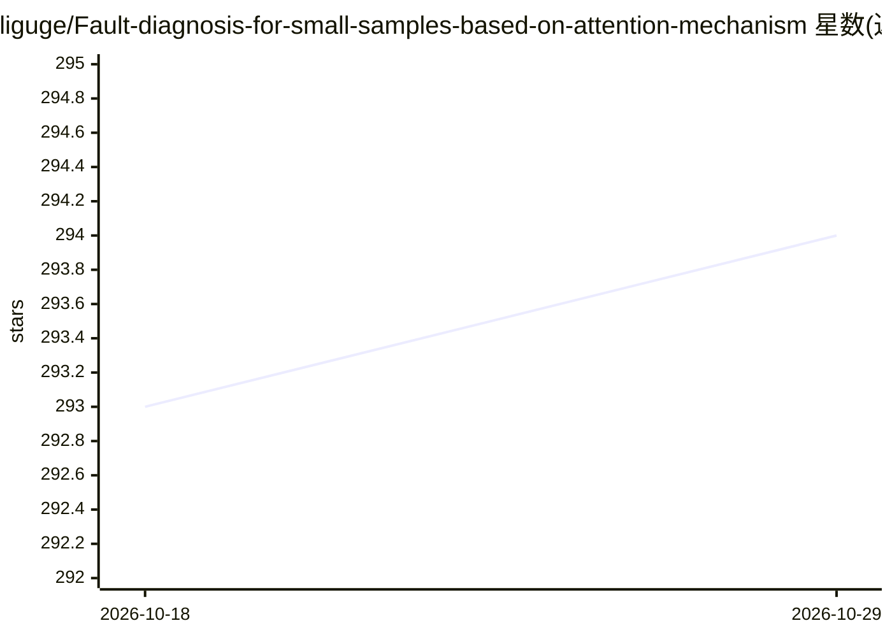

# liguge/Fault-diagnosis-for-small-samples-based-on-attention-mechanism

⭐ 294 · Python · 推送 2026-05-25 · [GitHub](https://github.com/liguge/Fault-diagnosis-for-small-samples-based-on-attention-mechanism) · 个人维护 · 中文 README

**论文代码：注意力机制的小样本旋转机械故障诊断（PyTorch）**

PyTorch 实现的论文代码库 DCA-BiGRU，对应论文《基于注意力机制的小样本故障诊断》（作者称更准确的题目含可解释改进空间-通道注意力机制与改进正则化算法）。数据集来自 12kHz、1hp 轴承信号。贡献包括 1D 信号注意力机制（SCA）、AMSGradP 优化器、1D-Meta-ACON、BiGRU 后接 GAP、1D-Grad-CAM++ 可视化与 AdaBN。README 给出环境版本（pytorch 1.10.0、python 3.8、cuda 10.2）与引用格式，未提供安装或运行命令。面向科研复现人员。

## 筛选速览

| 维度 | 判定 | 备注 |
|---|---|---|
| AI 角色 | `ai-native` | 本体是模型或模型工具 |
| 许可风险 | `none` | — |
| 部署形态 | `None` |  |
| 模型依赖 | — | README 未给出锁定关系 |
| 硬件要求 | — | 无带数字的原话,不猜 |
| 安装摩擦 | `medium` | 含编译或系统依赖之一 |
| 成熟度 | — | 结构信号不足 |

## 能力要点

- 1D 信号空间-通道注意力块（SCA）
- AMSGradP 与 1D-Meta-ACON 组件
- 1D-Grad-CAM++ 可解释性可视化
- AdaBN 域适应

## 适用场景

- 复现论文中的小样本故障诊断实验
- 在 12kHz 轴承数据上对比注意力机制模型
- 借用 1D 注意力或优化器组件做自己的诊断研究

## 场景标签

`科研工具` · 领域:学习与行业

## 证据(README 行号)

> L1: # DCA-BiGRU
> L2: The pytorch implementation of the paper Fault diagnosis for small samples based on attention mechanism
> L44: pytorch == 1.10.0

## 星数曲线

2026-10-18 293 → 2026-10-29 294（+1）

---
*卡片 v1 · prompt 1.4 · 生成 2026-10-22 · 置信度 high · 依据 README sha `bc51921acb04` · [字段定义](../../DATASET.md)*
