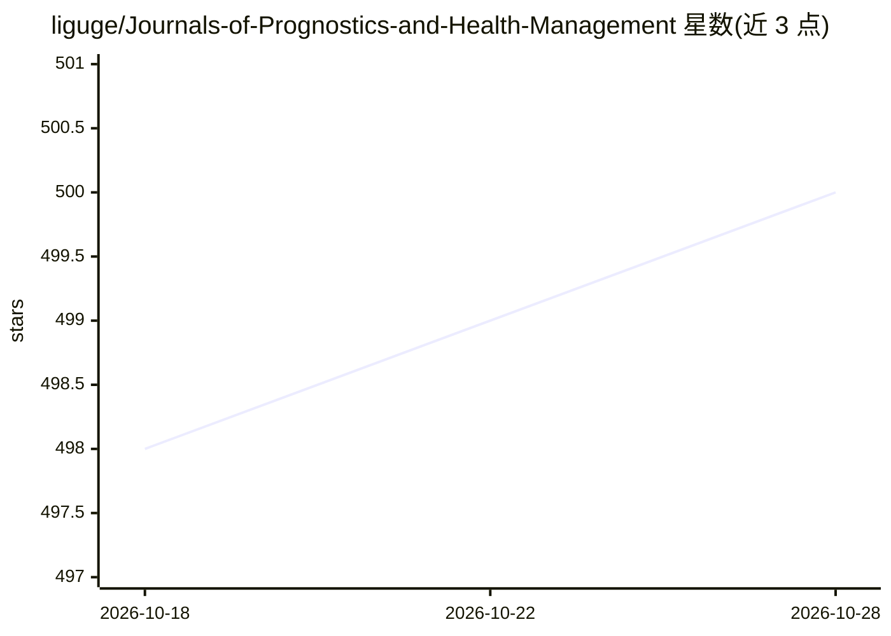

# liguge/Journals-of-Prognostics-and-Health-Management

⭐ 501 · 推送 2026-09-17 · [GitHub](https://github.com/liguge/Journals-of-Prognostics-and-Health-Management) · 个人维护 · 中文 README

**智能故障诊断与寿命预测领域英文期刊推荐清单**

面向智能故障诊断（IFD）与剩余寿命预测（RUL）研究者的英文期刊推荐列表：按表格整理各期刊的新锐分区表分区、SCI 影响因子、中科院小类分区、CCF/CAAI 等级、多个学会 T 分区与是否强制 OA 等信息，逐年更新影响因子、中科院分区、预警期刊与高质量科技期刊分级目录，标注升降级变化（↑/↓）。条目基于维护者阅读经验整理，欢迎通过 issue 补充，限制为可能收录不全。

## 筛选速览

| 维度 | 判定 | 备注 |
|---|---|---|
| AI 角色 | `ai-knowledge` | 知识聚合/清单类 |
| 许可风险 | `none` | — |
| 部署形态 | `None` |  |
| 模型依赖 | — | README 未给出锁定关系 |
| 硬件要求 | — | 无带数字的原话,不猜 |
| 安装摩擦 | `low` | 无编译、无系统依赖或容器化 |
| 成熟度 | — | 结构信号不足 |

## 能力要点

- 期刊条目含影响因子、中科院分区、CCF/CAAI 等级、学会 T 分区、强制 OA 等字段
- 逐年更新 SCI 影响因子、中科院升级版分区与各学会高质量期刊分级目录
- 标注分区升降级变化与中科院预警期刊名单

## 适用场景

- 查找智能故障诊断/寿命预测方向可投稿的英文期刊并了解其分区与评级
- 按所在学院认可的评定标准（CCF/中科院分区/学会目录）筛选目标期刊
- 投稿前核查目标期刊是否在预警名单或被标记 on_hold/非 SCIE

## 场景标签

`精选清单` · 领域:学习与行业

## 证据(README 行号)

> L2: ## Journals of Intelligent Fault Diagnosis (IFD) and Remaining Useful Life (RUL)
> L87: 笔者刚步入这个行业的时，做了很多无用功，研究收效甚微。高质量的论文有助于论文构思，实验设计和写作规范等。为让大家能够更早地阅读高质量论文，早日入门，所以做了这个英文期刊的推荐列表，主要目的有两个：一是帮助大家快速找到符合自己研究兴

## 星数曲线

2026-10-18 498 → 2026-10-28 500（+2）

---
*卡片 v1 · prompt 1.4 · 生成 2026-10-21 · 置信度 high · 依据 README sha `faeb6bf7d329` · [字段定义](../../DATASET.md)*
