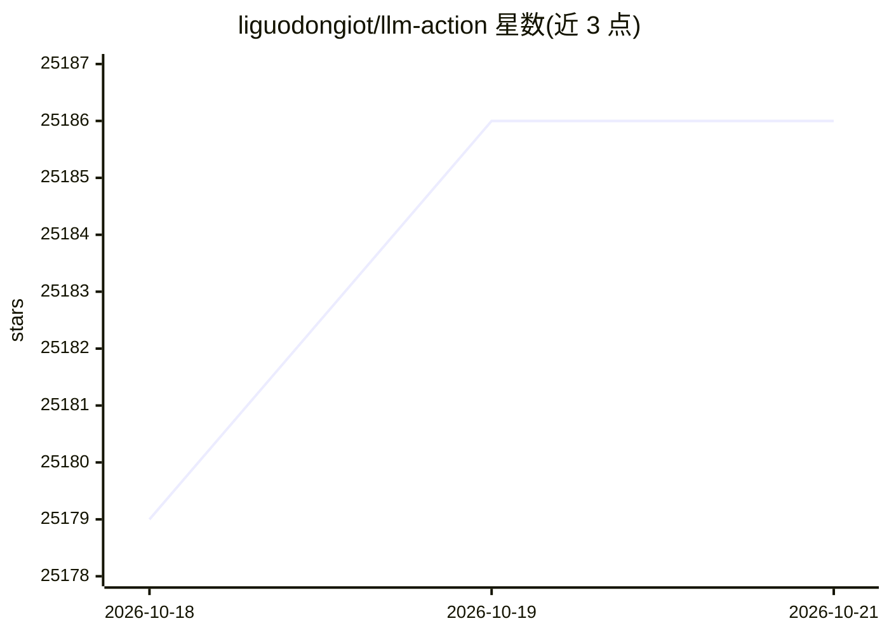

# liguodongiot/llm-action

⭐ — · [GitHub]() · 个人维护 · 中文 README

**大模型工程化与实践教程合集：覆盖训练、推理、压缩、评测**

以文章目录形式组织的大模型工程化知识库，内容按 LLM 训练、推理、压缩、测评、数据工程、提示工程、算法架构、应用开发等章节编排。训练部分汇总从 6B 到 65B、覆盖全量微调与 LoRA/QLoRA/P-Tuning v2 等高效微调及 RLHF 的实战教程；推理部分列出 vLLM、SGLang、TensorRT-LLM 等引擎与优化技术文章；另含分布式训练并行技术系列与量化/剪枝/蒸馏原理讲解。各条目多为外链教程，部分附带配套代码。

## 筛选速览

| 维度 | 判定 | 备注 |
|---|---|---|
| AI 角色 | `ai-knowledge` | 知识聚合/清单类 |
| 许可风险 | `permissive` | — |
| 部署形态 | `self-host` | docker 或自建部署 |
| 模型依赖 | — | README 未给出锁定关系 |
| 硬件要求 | — | 无带数字的原话,不猜 |
| 安装摩擦 | `low` | 无编译、无系统依赖或容器化 |
| 成熟度 | — | 结构信号不足 |

## 动量与使用信号

- 维护:`active` — 距上次 push 3.7 天,年发版 0,2 位贡献者
- 涨星:近 1 天 **+5**(自 20261016 起算)

## 能力要点

- 覆盖 6B–65B 模型的全量微调、LoRA/QLoRA/P-Tuning v2 与 RLHF 实战教程
- 九篇分布式训练并行技术系列（数据/流水线/张量/序列/自动并行等）
- 推理引擎汇总：vLLM、SGLang、TensorRT-LLM、LMDeploy 及轻量实现
- 量化（GPTQ/AWQ/SmoothQuant 等）、剪枝、知识蒸馏原理系列文章

## 适用场景

- 查找 LoRA/QLoRA 等高效微调方法的实战教程和配套代码
- 学习分布式训练并行技术的原理讲解
- 对比选择大模型推理引擎和推理性能压测工具
- 了解模型量化与压缩技术的原理系列文章

## 场景标签

`教程课程` · 领域:学习与行业

## 证据(README 行号)

> L6: ## LLM训练
> L120: ## LLM推理
> L182: ## LLM压缩

## 星数曲线

2026-10-18 25,179 → 2026-10-21 25,186（+7）

---
*卡片 v1 · prompt 1.4 · 生成 2026-10-18 · 置信度 mid · 依据 README sha `0ef3064a1bcf` · [字段定义](../../DATASET.md)*
