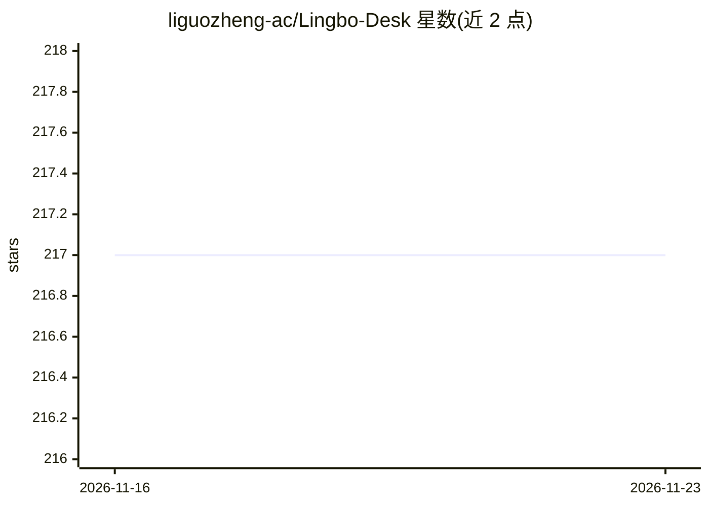

# liguozheng-ac/Lingbo-Desk

⭐ 217 · TypeScript · MIT · 推送 2026-11-19 · [GitHub](https://github.com/liguozheng-ac/Lingbo-Desk) · 个人维护 · 中文 README

**Windows 桌面语音 Agent：对话发起任务，后台执行并交付文件**

面向个人资料整理与文档工作的 Windows 桌面语音 Agent 原型：以持续对话发起任务，独立工作进程运行工具调用循环，处理文件、Office 文档与浏览器会话；支持暂停后修改要求、具体动作确认（目录权限、SHA256、备份）与以回执/产物哈希验收交付。含中/日/英语音识别与合成、原创 Live2D 角色、本地 Skills 与长期记忆。模型可在 DeepSeek 云端 API 与本机 Ollama 间切换。仅提供源码，安装包暂不公开；自述存在桌面卡顿等未确定问题，工作进程非操作系统沙箱。

## 筛选速览

| 维度 | 判定 | 备注 |
|---|---|---|
| AI 角色 | `ai-native` | 本体是模型或模型工具 |
| 许可风险 | `permissive` | MIT |
| 部署形态 | `None` |  |
| 模型依赖 | local-ok | 支持本地模型 |
| 硬件要求 | — | 无带数字的原话,不猜 |
| 安装摩擦 | `low` | 无编译、无系统依赖或容器化 |
| 成熟度 | `idea` | |

## 能力要点

- 前台对话与独立 Agent 工作进程分开调度，任务可暂停/修改/恢复/取消
- 文件修改前做权限校验、SHA256 检查与备份，执行回执与产物哈希验收交付
- 中/日/英语音识别合成、持续监听、自然插话，配原创 Live2D 角色
- DeepSeek 云端 API 与本机 Ollama 可切换，支持本地导入 Skills

## 适用场景

- 用语音或对话让 Agent 整理资料并生成 Word/Markdown 报告
- 执行中途补充或修改要求，再复核最终文件交付
- 带桌面角色的日常桌面办公助手

## 场景标签

`语音 Agent` `GUI 自动化` · 领域:效率与自动化

## 证据(README 行号)

> L20: 聆泊是 Windows 桌面语音 Agent 原型，将持续对话、原创 Live2D 角色和后台执行结合起来。面向个人资料整理与文档工作：任务运行时继续交流，需要调整时暂停改要求，涉及已有文件的修改先查看具体动作，最后下载并复核实际
> L75: |语音交流|中 / 日 / 英识别与合成、持续监听、自然插话、停止旧播报；音频切分后识别，不是端到端音频模型|
> L79: |记忆与模型|明确保存的长期记忆；DeepSeek 云端 API / 本机 Ollama 切换，语音服务单独配置|

## 星数曲线

2026-11-16 217 → 2026-11-23 217（+0）

---
*卡片 v1 · prompt 1.4 · 生成 2026-11-17 · 置信度 high · 依据 README sha `ea43e99a8454` · [字段定义](../../DATASET.md)*
