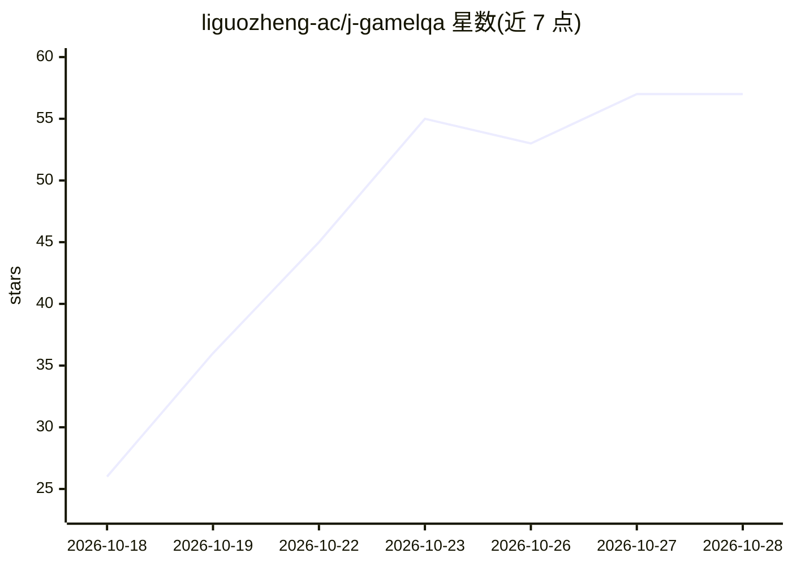

# liguozheng-ac/j-gamelqa

⭐ 57 · Python · MIT · 推送 2026-10-16 · [GitHub](https://github.com/liguozheng-ac/j-gamelqa) · 个人维护 · 中文 README

**中→日游戏本地化 QA 系统：规则检查混合上下文感知 LLM 评估**

面向中译日游戏文本的质检系统：将占位符、数字、标记、长度、术语等技术性检查交给确定性规则层（附明确证据），将误译、漏译、翻译腔、敬语、人称与角色语气等语义类检查交给结合游戏上下文（说话人、场景、前后文）的 LLM 层，通过混合路由汇总为共享 Issue 结构，供人工复核。附带 Streamlit 本地演示、CLI 与可复现评估流程；Hybrid v2.1 在 60 条冻结合成留存集上 F1 0.7030，但数据为小型合成集且 LLM 误报较多，未验证生产部署。

## 筛选速览

| 维度 | 判定 | 备注 |
|---|---|---|
| AI 角色 | `ai-native` | 本体是模型或模型工具 |
| 许可风险 | `permissive` | MIT |
| 部署形态 | `library` | 以包/库形式分发 |
| 模型依赖 | local-ok | 支持本地模型 |
| 硬件要求 | — | 无带数字的原话,不猜 |
| 安装摩擦 | `low` | 无编译、无系统依赖或容器化 |
| 成熟度 | — | 结构信号不足 |

## 能力要点

- 规则层与 LLM 层按问题类型混合路由，共享 Issue 数据结构
- LLM 评估结合说话人/场景/关系/前后文等游戏上下文
- 冻结的 60 条合成留存集评估：Hybrid v2.1 F1 0.7030（Precision 0.5859 / Recall 0.8788）
- 提供 Streamlit 本地演示与 rules/evaluate/llm-evaluate CLI

## 适用场景

- 游戏本地化交付前批量筛查中译日文本的技术性与语义性问题
- 译者和 QA 人员定位误译、敬语不当、人称与角色语气不一致等问题
- 对比规则、纯 LLM 与混合方案在本地化 QA 上的表现

## 场景标签

`模型评测` · 领域:评测与运维

## 证据(README 行号)

> L7: A hybrid quality assurance system for Chinese-to-Japanese game localization, combining deterministic rule checks wit
> L24: The frozen v1 candidate combines **Rule Baseline v1 + Qwen3.5-9B + Prompt v2.1 + With Context**. Hybrid routing use

## 星数曲线

2026-10-18 26 → 2026-10-28 57（+31）

---
*卡片 v1 · prompt 1.4 · 生成 2026-10-24 · 置信度 high · 依据 README sha `142c00093fa3` · [字段定义](../../DATASET.md)*
