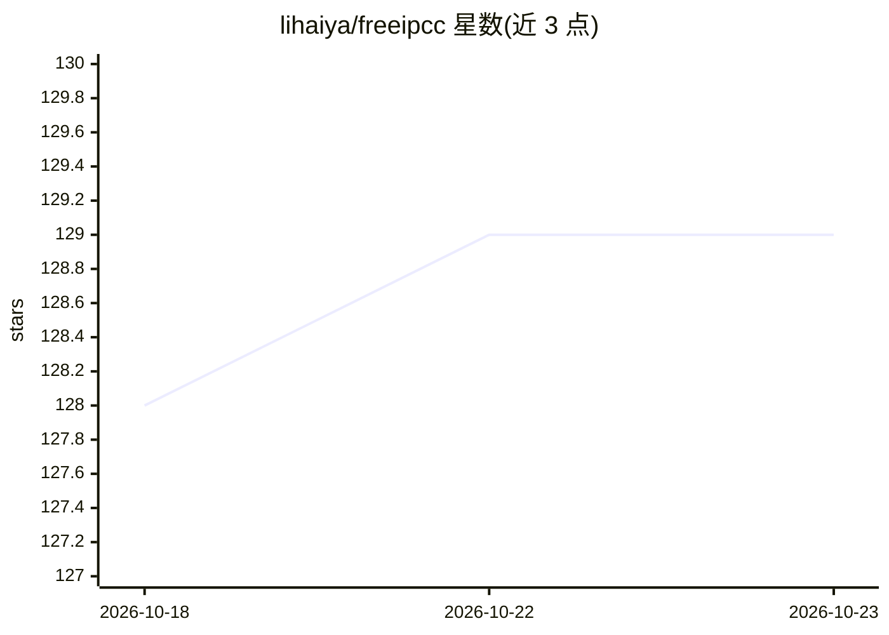

# lihaiya/freeipcc

⭐ 129 · TypeScript · NOASSERTION · 推送 2026-08-24 · [GitHub](https://github.com/lihaiya/freeipcc) · [官网](https://www.freeipcc.com) · 组织维护 · 中文 README

**开源大模型呼叫中心/客服系统：话务、工单、质检与AI机器人**

以 Java、Python 为主开发的开源呼叫中心与客服系统，功能包括多渠道接入（电话、短信、社交媒体、邮件、网页聊天）、智能路由、IVR、坐席管理、CRM 集成、数据分析报表与开放 API，并包含大模型呼入/呼出机器人、RAG 搜索模块等 AI 能力，可对接主流模型与私有模型。README 未给出安装运行步骤；源码模块需付费购买后可自用或商用，销售与部署采用对公合同并逐客户审核。

## 筛选速览

| 维度 | 判定 | 备注 |
|---|---|---|
| AI 角色 | `ai-enhanced` | 去掉 AI 部分产品仍成立 |
| 许可风险 | `none` | NOASSERTION |
| 部署形态 | `None` |  |
| 模型依赖 | — | README 未给出锁定关系 |
| 硬件要求 | — | 无带数字的原话,不猜 |
| 安装摩擦 | `low` | 无编译、无系统依赖或容器化 |
| 成熟度 | — | 结构信号不足 |

## 能力要点

- 多渠道接入（电话/短信/社交媒体/邮件/网页聊天）与统一管理
- 智能路由、IVR、坐席管理、工单与质检系统
- 大模型呼入/呼出机器人，可对接主流模型与私有模型
- 开放 API 与插件扩展、云原生架构

## 适用场景

- 企业搭建自有呼叫中心与在线客服体系
- 在电话客服场景中接入大模型机器人处理呼入呼出
- 替代思科/Avaya 呼叫中心并利旧对接（README 自述）

## 场景标签

`语音 Agent` `聊天机器人` · 领域:对话与助手

## 证据(README 行号)

> L2: Call Center，Contact Center，呼叫中心，客服系统，工单系统，智能外呼，大模型呼叫中心，智能呼叫中心，RAG搜索模块，AI；FreeSWITCH，LLM Call Center,AI Call Center,大
> L43: 1.	多渠道接入：支持电话、短信、社交媒体、电子邮件、网页聊天等多种客户沟通渠道，实现客户需求的无缝对接与统一管理。
> L44: 2.	智能路由：基于预设规则或AI算法，自动将客户请求分配给最合适的客服代表或自助服务模块，确保客户问题得到及时、专业的处理。

## 星数曲线

2026-10-18 128 → 2026-10-23 129（+1）

---
*卡片 v1 · prompt 1.4 · 生成 2026-10-22 · 置信度 low · 依据 README sha `9c35e1439b21` · [字段定义](../../DATASET.md)*
