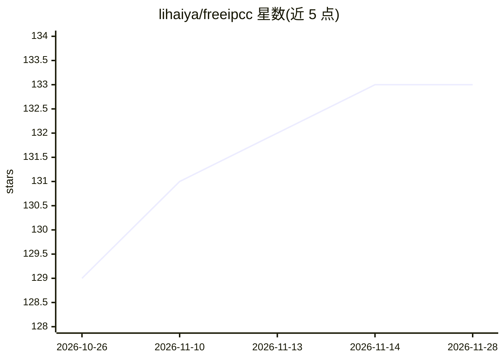

# lihaiya/freeipcc

⭐ 133 · TypeScript · Apache-2.0 · 推送 2026-11-24 · [GitHub](https://github.com/lihaiya/freeipcc) · [官网](https://www.freeipcc.com) · 组织维护 · 中文 README

**面向企业的开源大模型呼叫中心与客服系统**

以 FreeSWITCH 为语音底座的开源呼叫中心/客服系统，功能覆盖话务、工单、质检、IVR、坐席管理与多渠道接入（电话、短信、社交媒体、邮件、网页聊天）。宣称将大模型用于呼入/呼出机器人与客服对话，含 RAG 搜索模块，可对接主流模型与私有模型。开发语言以 Java、Python 为主。10 坐席以内可部署一体化版本；源码采用付费购买模式，购买后可自用与商用，并需对公合同审核用途。

## 筛选速览

| 维度 | 判定 | 备注 |
|---|---|---|
| AI 角色 | `ai-enhanced` | 去掉 AI 部分产品仍成立 |
| 许可风险 | `permissive` | Apache-2.0 |
| 部署形态 | `None` |  |
| 模型依赖 | — | README 未给出锁定关系 |
| 硬件要求 | — | 无带数字的原话,不猜 |
| 安装摩擦 | `low` | 无编译、无系统依赖或容器化 |
| 成熟度 | `idea` | |

## 能力要点

- 基于 FreeSWITCH 的呼叫中心话务底座
- 多渠道接入：电话、短信、社交媒体、邮件、网页聊天
- 话务、工单、质检系统集成
- RAG 搜索模块，可对接主流模型与私有模型

## 适用场景

- 搭建企业呼入/呼出电话客服与机器人应答
- 管理工单、坐席与质检流程
- 对接 CRM 与主流/私有模型构建客服体系

## 场景标签

`RAG` `聊天机器人` `语音 Agent` · 领域:对话与助手

## 证据(README 行号)

> L2: Call Center，Contact Center，呼叫中心，客服系统，工单系统，智能外呼，大模型呼叫中心，智能呼叫中心，RAG搜索模块，AI；FreeSWITCH，LLM Call Center,AI Call Center,大
> L10: ## 😄语音底座：FreeSWITCH为底座，非Asterisk等旧平台！
> L46: 1.	多渠道接入：支持电话、短信、社交媒体、电子邮件、网页聊天等多种客户沟通渠道，实现客户需求的无缝对接与统一管理。

## 星数曲线

2026-10-26 129 → 2026-11-28 133（+4）

---
*卡片 v1 · prompt 1.4 · 生成 2026-11-28 · 置信度 mid · 依据 README sha `f5b09b48e0dc` · [字段定义](../../DATASET.md)*
