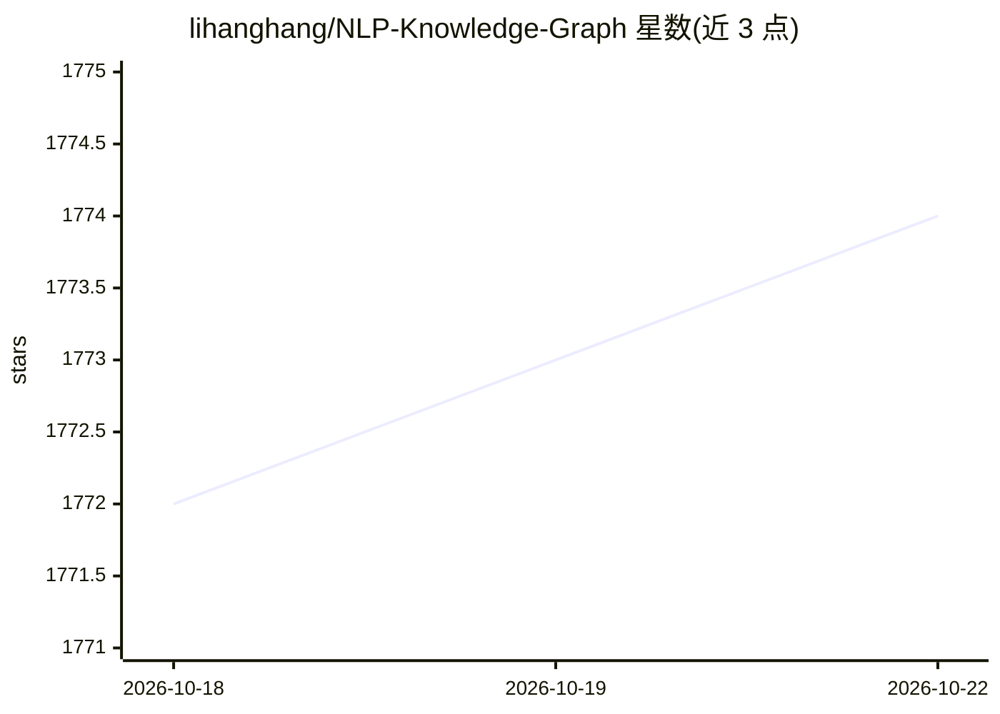

# lihanghang/NLP-Knowledge-Graph

⭐ 1,774 · JavaScript · MIT · 推送 2026-10-21 · [GitHub](https://github.com/lihanghang/NLP-Knowledge-Graph) · [官网](kg.lihanghang.top) · 个人维护 · 中文 README

**知识图谱与 NLP/LLM 领域的个人研究整理与资源清单**

个人维护的认知智能领域知识整理仓库：围绕知识图谱、NLP、对话系统与大语言模型，收录研究总结列表、论文解析（BERT/ERNIE/T5 等）、会议分级、开源问答系统与语义平台列表、文本预处理工具、图存储与可视化工具、中英文知识图谱数据集，以及按年份更新的个人思考笔记（追踪从 ChatGPT 到 DeepSeek-R1 的 LLM 发展）。条目以中文为主，供研究学习者查阅，不含可运行代码。

## 筛选速览

| 维度 | 判定 | 备注 |
|---|---|---|
| AI 角色 | `ai-knowledge` | 知识聚合/清单类 |
| 许可风险 | `permissive` | MIT |
| 部署形态 | `None` |  |
| 模型依赖 | — | README 未给出锁定关系 |
| 硬件要求 | — | 无带数字的原话,不猜 |
| 安装摩擦 | `low` | 无编译、无系统依赖或容器化 |
| 成熟度 | — | 结构信号不足 |

## 能力要点

- 覆盖 KG 构建、KBQA、事理图谱、对话系统等专题的论文与文章列表
- 中英文文本预处理工具、图存储查询、可视化工具的对比列表
- 10 个中文知识图谱数据集条目
- 2019-2025 年逐年更新的 LLM 领域思考笔记

## 适用场景

- 查找知识图谱与 KBQA 方向的入门论文与综述
- 选型中文分词/NLP 工具与图数据库时参考工具列表
- 获取中文知识图谱公开数据集线索

## 场景标签

`精选清单` · 领域:学习与行业

## 证据(README 行号)

> L20: > 包括知识获取、知识库构建、基于知识库的问答系统系列技术研究与应用。涉及到NLP领域的前沿技术和论文。
> L202: - 以上内容均为个人在学习过程的相关整理（包含互联网内容、个人整理笔记等），希望对研究学习认知智能领域的小伙伴有帮助。

## 星数曲线

2026-10-18 1,772 → 2026-10-22 1,774（+2）

---
*卡片 v1 · prompt 1.4 · 生成 2026-10-21 · 置信度 high · 依据 README sha `979b4108a9f9` · [字段定义](../../DATASET.md)*
